# 孩子数学学习规划（幼儿园 → 小学 → 初中 → 高中）

> 写给家长的一份长期路线图：每个学段该重点学什么、难点在哪、怎么衔接、怎么辅导。

---

## 目录

- [一、如何使用这份规划](#一如何使用这份规划)
- [二、课标依据与总览](#二课标依据与总览)
- [三、第一阶段：幼儿园（3~6 岁）](#三第一阶段幼儿园36-岁)
- [四、第二阶段：小学（6~12 岁）](#四第二阶段小学612-岁)
  - [4.1 低年级（1~2 年级）](#41-低年级12-年级)
  - [4.2 中年级（3~4 年级）](#42-中年级34-年级)
  - [4.3 高年级（5~6 年级）](#43-高年级56-年级)
- [五、第三阶段：初中（13~15 岁）](#五第三阶段初中1315-岁)
- [六、第四阶段：高中（16~18 岁）](#六第四阶段高中1618-岁)
- [七、数学有用与兴趣保护](#七数学有用与兴趣保护)
- [八、关键节点与危险期：几月做什么、家长怎么做](#八关键节点与危险期几月做什么家长怎么做)
- [附录 A：核心素养发展对照表](#附录-a核心素养发展对照表)
- [附录 B：全学段易错点速查清单](#附录-b全学段易错点速查清单)
- [附录 C：给家长的通用建议](#附录-c给家长的通用建议)
- [附录 D：易错难记点的"邪修"记忆法](#附录-d易错难记点的邪修记忆法)

---

## 一、如何使用这份规划

1. **先看总览表**建立整体认识，再按孩子当前学段细读。
2. 每个学段都按固定结构编排：**知识模块 → 重点难点 → 常见易错点 → 学习方法 → 能力目标 → 衔接要点**，可直接对照检查孩子的掌握情况。
3. 文中标注有两类说明：
   - 【课标对齐】依据 2022 版《义务教育数学课程标准》和 2017 版《普通高中数学课程标准》的官方要求；
   - 【通用规律】不依赖特定教材版本、体现儿童数学能力一般发展规律的内容。
4. 这份文档是"主干框架"，不替代教材和课堂。孩子的校内进度、教材版本（人教版/北师大版等）进度略有差异，以学校教学为准。

## 二、课标依据与总览

**依据说明：**
- 义务教育阶段执行 **2022 版《义务教育数学课程标准》**，划分为四个学段：第一学段（1~2 年级）、第二学段（3~4 年级）、第三学段（5~6 年级）、第四学段（7~9 年级，即初中）。课程目标围绕"三会"核心素养：会用数学的眼光观察现实世界、会用数学的思维思考现实世界、会用数学的语言表达现实世界。
- 高中执行 **2017 版《普通高中数学课程标准》（2020 年修订）**，课程分必修、选择性必修、选修；核心素养包括六个方面：数学抽象、逻辑推理、数学建模、直观想象、数学运算、数据分析。

**十二年学习路径总览：**

| 阶段 | 领域主线 | 思维发展主线 | 核心素养关键词 |
|---|---|---|---|
| 幼儿园 | 数感、图形、规律启蒙 | 从"玩"中感知数学 | 兴趣、数感萌芽 |
| 小学低年级 | 计算基础、量的认识 | 具体形象思维 → 初步抽象 | 数感、运算能力 |
| 小学中年级 | 运算律、分数小数、度量 | 从"算"到"算得有道理" | 符号意识、几何直观 |
| 小学高年级 | 分数四则、比例、方程萌芽 | 算术思维 → 代数思维过渡 | 推理意识、模型意识 |
| 初中 | 函数、几何证明、方程建模 | 常量思维 → 变量思维；从"看"到"证" | 推理能力、模型观念、抽象能力 |
| 高中 | 函数与导数、解析几何、概率统计 | 从具体到抽象、从计算到思想方法 | 数学抽象、逻辑推理、数学建模 |

【通用规律】整个十二年呈三条螺旋上升的主线：**数与运算**（数的范围不断扩充：自然数→分数小数→有理数→实数→复数）、**几何**（直观感知→度量计算→演绎证明→坐标化与向量化）、**函数与建模**（幼小萌芽→小学比例→初中三类函数→高中函数体系与导数）。

---

## 三、第一阶段：幼儿园（3~6 岁）

**定位：** 不是"提前上课"，而是做好**数学启蒙与幼小衔接**。幼儿园阶段没有统一教材，以下按幼小衔接的通行要求整理。

### 3.1 知识模块

| 模块 | 具体内容 |
|---|---|
| 数感启蒙 | 按物点数（1~20）、10 以内数的分与合（如 7 可以分成 3 和 4）、10 以内加减的实物操作、比较 5/10/20 以内数量的多少 |
| 图形与空间 | 认识圆形、正方形、三角形、长方形；上下、前后、左右方位；简单拼搭与图形组合 |
| 量与规律 | 比较长短/高矮/轻重/多少；按颜色、形状、大小分类与排序；发现 ABAB、AABB 等简单规律并续排 |
| 时间与生活 | 认识整点、半点的钟面；感知昨天/今天/明天；认识钱币面值，模拟购物找零 |

### 3.2 重点

- **10 以内数的分与合**是幼小衔接最核心的基础——它是小学 20 以内进退位加减法的"地基"，务必让孩子做到脱口而出。
- **数感的建立**：数量与数字符号对应、估一估有多少、按数取物。

### 3.3 常见误区（家长最易踩的坑）

- ❌ 超前学多位数加减、背乘法口诀：机械记忆挤压了理解空间，到小学反而"吃老本"、上课不专注。
- ❌ 用大量练习题代替操作体验：这个年龄段孩子的思维是"手先会想"，需要摆一摆、分一分、数一数。

### 3.4 学习方法

- **生活化**：分水果、摆碗筷（一一对应）、超市购物算钱、看时钟说时间、搭积木认图形。
- **游戏化**：扑克牌比大小、骰子加法游戏、跳房子数数、规律串珠。
- 每天碎片化 10~15 分钟即可，**保护兴趣比追求速度重要**。

### 3.5 能力目标（幼升小时应达到）

- 能按物点数、说出总数；10 以内分合熟练；会 10 以内加减；
- 认识常见图形和上下左右；会比较、分类、找规律；
- 对数学有好奇心和"数学有用"的初步体验。

---

## 四、第二阶段：小学（6~12 岁）

【课标对齐】小学对应 2022 课标的第一~第三学段，四大内容领域为：**数与代数、图形与几何、统计与概率、综合与实践**。以下按三个学段拆解。

### 4.1 低年级（1~2 年级）

**知识模块：**

| 领域 | 内容 |
|---|---|
| 数与代数 | 20 以内进位加/退位减；100 以内加减（口算、笔算、估算）；万以内数的认识（数位、读写、大小比较）；表内乘法与表内除法（乘法口诀）；有余数的除法；认识人民币与简单计算；认识钟表（几时几分）；简单的排列搭配 |
| 图形与几何 | 辨认长方形、正方形、三角形、圆和常见立体图形（长方体、正方体、圆柱、球）；角的初步认识（直角、锐角、钝角）；长度单位（厘米、米）、质量单位（克、千克）及测量；从不同位置观察物体 |
| 统计与概率 | 按标准分类、简单的数据收集与整理（象形统计图、简单统计表） |
| 综合与实践 | 购物、测量身体、校园中的数学等活动 |

**重点：**
- **20 以内进退位加减**——一辈子用得最多的计算，要求达到自动化（不假思索、脱口而出）。
- **乘法口诀**——二年级全年的"硬骨头"，要求横背、竖背、抽背都熟。
- 计算**准确率**优先于速度。

**易错点：**
- 进位加法忘加进上来的"1"、退位减法忘减退下去的"1"；
- 口诀记混（如"六七四十二"与"六八四十八"）；
- 人民币单位换算（1 元=10 角）和钟表认读（接近整时时针的位置）；
- 有余数除法中"余数比除数大"（余数必须小于除数）；万以内数读写时中间、末尾的 0 处理。

**学习方法：**
- 每天 5~10 分钟口算打卡，重在坚持；
- 用小棒、计数器理解算理，不要只背竖式口诀；
- 让孩子当"小掌柜""小闹钟"，在生活中用数学。

**能力目标：** 数感与运算能力初步形成，能用数学解决简单生活问题，养成书写工整、做完检查的习惯。

### 4.2 中年级（3~4 年级）

**知识模块：**

| 领域 | 内容 |
|---|---|
| 数与代数 | 万以上数的认识与读写（含近似数、四舍五入）；三位数乘两位数、除数是两位数的除法；四则混合运算顺序；运算律（加法交换/结合、乘法交换/结合/分配）与简便运算；分数的初步认识（几分之一、几分之几、简单加减）；小数的初步认识与一位小数计算；年、月、日与 24 时计时法 |
| 图形与几何 | 角的度量（量角器）、角的分类；直线、射线、线段；平行与垂直；三角形和四边形的初步认识；长方形、正方形的周长与面积（含面积单位：公顷、平方千米）；位置与方向（东南西北等八个方向、简单的路线图）；平移、旋转、轴对称 |
| 统计与概率 | 条形统计图（1 格代表多个单位）、平均数的初步认识 |
| 综合与实践 | 测量（面积/长度实地测量）、数学小课题研究；数学广角：优化（烙饼、沏茶）、鸡兔同笼等经典数学思想 |

**重点：**
- **运算律与简便运算**——中年级最重要的"思想方法"，是后续代数变形的雏形；
- **分数的初步认识**——小学阶段第一个真正的抽象概念（"平均分"），是后续全部分数知识的地基；
- **除数是两位数的除法**（试商、调商）是计算能力的分水岭。

**易错点：**
- 试商不准、余数处理错误；
- 分数意义理解偏差：把"分成 4 份"当成"平均分成 4 份"；
- **周长与面积混淆**（单位混用、公式记串）；面积单位进率（1 公顷=10000 平方米）易错；
- 混合运算顺序错误；
- 年月日：平年闰年判断（整百年份要能被 400 整除）、经过时间计算（跨天、跨时段的减法）。

**学习方法：**
- 开始建立**错题本**（按"计算错误/概念不清/审题失误"分类）；
- 画图理解概念：分数画"平均分"图、周长面积画标注图；
- 简便运算题多交流"为什么这么算"，而不是只追求答案。

**能力目标：** 符号意识萌芽（用字母表示规律的初步体验）、几何直观与空间观念发展、能进行有条理的思考与表达。

### 4.3 高年级（5~6 年级）

**知识模块：**

| 领域 | 内容 |
|---|---|
| 数与代数 | 因数与倍数（2/3/5 的倍数特征、质数与合数、最大公因数、最小公倍数）；分数的意义、性质与四则运算；小数的意义与性质、小数加减法及四则混合运算；**比和比例**（比例尺、正比例反比例）；**百分数**；负数初步认识；**简易方程**（用字母表示数、等式性质、解一元一次方程） |
| 图形与几何 | 平行四边形、三角形、梯形的面积；**圆**（周长、面积）；长方体、正方体的表面积与体积（含容积单位升、毫升）；**圆柱与圆锥**（体积、表面积）；数对与位置（用数对、方向与距离确定位置）；观察物体 |
| 统计与概率 | 折线统计图、扇形统计图；可能性（等可能性、可能性大小） |
| 综合与实践 | 数学广角：植树问题、找次品、鸽巢问题等经典数学思想 |

**重点：**
- **分数四则运算**——小学计算的最高峰，直接影响初中代数；
- **比和比例、百分数**——与生活（折扣、利息、浓度、比例尺）联系最紧密的内容；
- **简易方程**——算术思维向代数思维过渡的桥梁，"用字母表示数"是关键一跃；
- **圆与圆柱圆锥**——平面到立体的综合度量。

**易错点：**
- 分数应用题中**单位"1"的判断**（这是整个小学应用题的第一难点）；
- 比例尺是图上距离∶实际距离，单位要统一；
- 圆柱与圆锥体积的 3 倍关系（等底等高前提常被忽略）；
- 简便运算中盲目"凑整"违反运算顺序；
- 数对先列后行（列在前、行在后，别写反）；容积与体积单位混用（1 升=1 立方分米）。

**学习方法：**
- 应用题坚持**画线段图/示意图**，把数量关系"画出来"；
- 同一道应用题分别用算术方法和方程方法解，体会两种思维的差异；
- 整理"数量关系公式本"（速度×时间=路程、单价×数量=总价、利息=本金×利率×时间等）。

**能力目标：** 推理意识与模型意识初步形成；能用字母和方程表达数量关系；几何计算从公式套用走向理解推导。

**小初衔接要点：**
1. 计算功底：分数小数混合运算熟练、规范；
2. 方程思想：不再只依赖算术倒推，初步体会"设未知数—找等量关系—列方程—求解"；
3. 几何从"看图计算"向"说理证明"过渡的准备：开始有意识地问"为什么"。

---

## 五、第三阶段：初中（13~15 岁）

【课标对齐】初中对应 2022 课标第四学段（7~9 年级），核心素养表现聚焦：**抽象能力、运算能力、几何直观、空间观念、推理能力、数据观念、模型观念、应用意识、创新意识**。

### 5.1 知识模块（按人教版常见进度，各版本略有差异）

| 年级 | 数与代数 | 图形与几何 | 统计与概率 |
|---|---|---|---|
| 七年级 | 有理数（数轴、相反数、绝对值、四则运算、科学记数法）；整式加减；一元一次方程；实数（平方根、立方根）；二元一次方程组；一元一次不等式（组） | 几何图形初步（线段、角）；相交线与平行线（含命题、平移）；平面直角坐标系 | 数据的收集、整理与描述 |
| 八年级 | 整式乘法与因式分解；分式；二次根式；一次函数 | 三角形（全等、等腰、直角三角形）；**命题与证明**（命题、逆命题、反例、反证法初步）、**尺规作图**；勾股定理；平行四边形（矩形、菱形、正方形） | 数据的分析（中位数、众数、方差） |
| 九年级 | 一元二次方程；二次函数；反比例函数 | 旋转与中心对称；**圆**（垂径定理、圆周角、切线、弧长与扇形面积）；相似三角形；锐角三角函数；投影与视图 | 概率初步（列举法、画树状图/列表求概率） |

### 5.2 重点难点

- **函数思想（初中第一难点）**：从"研究固定的数"转向"研究变化的关系"。一次函数（直线）→ 反比例函数（双曲线）→ 二次函数（抛物线），重点是**图像与性质的对应**：看到解析式能想象图像，看到图像能读出性质。
- **几何证明**：从全等三角形开始建立"已知→求证→依据"的完整逻辑链，每一步都要有定理依据；相似和圆是几何综合题的高峰。八年级的"命题与证明"一章是这套逻辑的**概念地基**（什么是命题、逆命题、反例、反证法），不要略过；尺规作图则训练"动手作图 + 说理依据"的结合。
- **方程与建模**：一元一次→二元一次→一元二次→分式方程、不等式，核心套路是"审、设、列、解、验、答"。
- **因式分解**：代数变形的基本功，贯穿整个中学。

### 5.3 常见易错点

- 符号错误：去括号、移项不变号；有理数乘方符号判断；
- 不等式两边乘除负数忘记**变号**；
- 分式方程**漏验根**（分母不为零）；
- 函数题忽略自变量取值范围；
- 几何证明跳步、依据缺失；辅助线"想不到"（需积累常见模型：倍长中线、截长补短、旋转模型等）；
- 概率题列举不重复、不遗漏。

### 5.4 学习方法

- **错题本升级为"错因本"**：每道错题标注知识漏洞还是方法漏洞；
- **一题多解、多题一解**：尤其几何题，鼓励孩子讲出"为什么这样做辅助线"；
- **从"算出来"到"讲清楚"**：让孩子当小老师讲题，是训练逻辑表达最有效的方式；
- 证明过程规范书写，从七年级就养成"步步有据"的习惯。

### 5.5 能力目标

能进行符号化的代数变形与演绎推理；能用函数、方程、不等式刻画现实情境（模型观念）；能处理数据并对随机现象做初步判断（数据观念、概率意识）。

**初高衔接要点：**
1. **函数概念升级**：初中"两个变量的关系"→ 高中"集合之间的对应（映射）"，需要孩子摆脱"解析式=函数"的狭义理解；
2. **代数变形能力**：因式分解、分式、根式运算的熟练度直接决定高中解析几何的运算速度；
3. **逻辑规范**：高中立体几何、导数证明对论证严谨性要求更高，初中的证明训练是地基。

---

## 六、第四阶段：高中（16~18 岁）

【课标对齐】高中执行 2017 版课标（2020 修订），课程分为**必修**（学业水平考试依据，全体学生）与**选择性必修**（高考主要范围，选考学生）。新高考改革下数学为统考必考科目。

### 6.1 必修课程（高一~高二上）

| 模块 | 内容 |
|---|---|
| 预备知识 | 集合、常用逻辑用语（充分/必要条件、全称量词与存在量词）、一元二次函数与方程、不等式（基本不等式） |
| 函数 | 函数的概念与性质（定义域、值域、单调性、奇偶性、幂函数、零点与二分法）；指数与对数函数；三角函数（任意角与弧度制、图像与性质、诱导公式、恒等变换、图像变换 y=Asin(ωx+φ)）；**解三角形**（正弦定理、余弦定理及应用） |
| 几何与代数 | 平面向量（含向量的应用）；复数；立体几何初步（空间点线面关系、简单几何体） |
| 概率与统计 | 随机抽样、用样本估计总体（含频率分布直方图、百分位数）；古典概型、概率的基本性质 |
| 综合实践 | 数学建模活动与数学探究活动 |

### 6.2 选择性必修课程（高二~高三）

| 模块 | 内容 |
|---|---|
| 空间向量与立体几何 | 空间向量运算、用向量法求线面角、二面角 |
| 平面解析几何 | 直线与圆的方程；**圆锥曲线**（椭圆、双曲线、抛物线的定义、方程与几何性质） |
| 数列 | 等差数列、等比数列、数列求和、递推思想、**数学归纳法** |
| 一元函数导数 | 导数概念、运算、用导数研究单调性、极值与最值 |
| 计数原理 | 分类加法/分步乘法计数、排列组合、二项式定理 |
| 概率与统计 | 条件概率、随机变量及其分布（二项分布、超几何分布、正态分布）、成对数据的统计分析（相关系数、一元线性回归、**独立性检验**） |

### 6.3 重点难点（对接高考五大主干板块）

1. **函数与导数**（高考压轴常客）：抽象函数性质、导数研究单调性与极值、构造函数证明不等式；
2. **解析几何**：圆锥曲线的几何性质与代数运算结合，运算量大，需"几何先行、设而不求"等技巧；
3. **三角函数与解三角形**：图像性质、恒等变换与解三角形的综合（正余弦定理常与向量、实际测量题结合）；
4. **数列**：等差等比的基本量思想、递推与求和技巧（错位相减、裂项相消）；
5. **概率统计**：与实际问题结合紧密，新高考中比重上升。

**难点本质：** 高中数学难在**抽象层次**——从具体函数到抽象函数、从具体图形到参数讨论、从会算到会证。

### 6.4 常见易错点

- 忽略函数**定义域**这一"第一纪律"；
- 对数运算性质记混、丢真数大于零的条件；
- 三角恒等变换符号错误（诱导公式"奇变偶不变，符号看象限"）；
- 解三角形时"已知两边及其中一边对角"出现两解却漏解（正弦定理的多解问题）；余弦定理符号用错；
- 立体几何建系时坐标设错、法向量求错；
- 圆锥曲线联立方程后韦达定理用错或不算判别式；
- 概率题分不清"放回/不放回""有序/无序"；
- 分类讨论**不重不漏**的意识不足。

### 6.5 学习方法

- **知识网络化**：每个模块学完后画知识结构图（如"函数"一张图：概念→性质→初等函数→应用）；
- **题型 → 思想方法**双向归纳：题目做厚再读薄，最终沉淀的是思想（数形结合、分类讨论、转化化归、函数与方程）；
- **限时训练**：高考是时间与准确率的平衡，平时练习就要计时；
- 高三一轮重基础重体系、二轮重专题重方法、三轮重套卷重心态。

### 6.6 能力目标

达到课标六大核心素养：数学抽象、逻辑推理、数学建模、直观想象、数学运算、数据分析——这既是高考要求，也是大学学习和未来职业（理工科、金融、数据科学等）的底层能力。

---

## 七、数学有用与兴趣保护

> 很多家长最头疼的两件事：孩子问"数学有什么用"，以及孩子"越来越怕数学"。这一章专门回答这两个问题。

### 7.1 让孩子看见"数学有用"

**数学有用不是一句口号，要具体到场景。** 建议家长对照下表，有意识地在生活中"指给孩子看"。

**（1）生活中的数学**

| 场景 | 可以带孩子做的事 |
|---|---|
| 购物 | 比较折扣（八折 vs "满 200 减 30"哪个划算）、算单价（大包装真的便宜吗）、凑单技巧 |
| 理财 | 压岁钱存银行的利息怎么算、零花钱记账、复利小实验 |
| 出行 | 看导航比较两条路线、计算车程与到达时间、旅行预算分配 |
| 家庭决策 | 装修算面积定地砖涂料用量、家庭月度开支统计 |
| 健康 | BMI 指数、运动配速、药品剂量换算 |
| 厨房 | 菜谱翻倍/减半的配比、烘焙称重、做饭的时间统筹 |
| 时间管理 | 倒计时规划作业、日程安排 |

**（2）其他学科中的数学**

- 物理几乎就是"数学的语言"；化学靠配比与计量；地理用比例尺、等高线；生物算遗传概率。
- 编程/信息课：算法的本质就是数学；音乐里的节拍与分数、美术里的透视与对称，也都离不开数学。

**（3）未来职业中的数学**

- 工程师、建筑师：结构计算与设计；医生、药师：剂量与医学统计；
- 金融、经济：利率与风险模型；程序员、人工智能：算法与机器学习；
- 数据分析师、电商运营：转化率、增长率的统计思维；设计师：几何与比例。

**（4）数学思维是数字时代的"防忽悠"素养**

- 看懂新闻里的数字：增长率 50% 的基数是多少？平均数背后的分布是什么？
- 识别促销套路：先涨价后打折、用百分比混淆绝对数。
- 理解概率：中奖率、患病率的正确解读，不迷信"运气"。
- 估算能力：快速判断一个数字"合不合理"——这是未来竞争力的重要组成部分。

【通用规律】孩子对"有用"的理解是具体的、即时的：讲大道理，不如让他用 10 块钱算清一次折扣。

### 7.2 分学段兴趣保护策略

数学兴趣有**两个最危险的时期**：三四年级（题目变难、差距显现）和初二（函数与几何证明的抽象度跳升）。完整的"五个危险期"清单与家长行动指南见第八章。分学段策略如下：

| 学段 | 保护策略 |
|---|---|
| 幼儿园 | 玩优先，数学藏进游戏；不测试、不比较 |
| 小学低年级 | 打卡量小而稳，保护"我能行"的感觉；记录进步曲线而非只看分数 |
| 小学中年级 | 分数等概念卡壳很正常：放慢、画图、用实物；允许孩子说"我再想想" |
| 小学高年级 | 应用题多联系生活（折扣、地图比例尺）；数学广角类趣味题保护探究欲；拓展以兴趣为前提 |
| 初中 | 几何证明"卡住"是常态，引导孩子体验"柳暗花明"的乐趣；展示数学之美（函数图像、对称）；不因一次失利否定整个学科 |
| 高中 | 引入数学史与数学文化；建模连接真实问题；帮孩子区分"没学好"和"本来就难"——挫败感是学科属性而非个人失败 |

### 7.3 家长行为红黑榜

| ✅ 多做 | ❌ 不做 |
|---|---|
| 具体地夸过程："这道题你试了三种方法" | 笼统夸"真聪明"（反而让孩子怕失败） |
| 让孩子当小老师教你 | 说"这有什么难的"（否定孩子的感受） |
| 展示自己用数学解决真实问题 | 说"我小时候数学就不好"（给逃避找借口） |
| 把错误当线索，一起找原因 | 当众批评数学成绩、拿别人家孩子比较 |
| 关注进步幅度而非绝对排名 | 用超前学换"上课不听"（摧毁课堂兴趣） |
| 陪找资源、陪找方法 | 用数学成绩奖惩其他事情、过度刷题挤占睡眠 |

### 7.4 怎么回应"数学有什么用"

1. **不要答"考试要考"**——这是最差的答案，等于承认它真的没用。
2. **用反问接住好奇心**："你猜外卖怎么预估送达时间？游戏暴击率怎么设计？"——把问题变成一次探索。
3. **一起用数学解决他真正关心的问题**：买哪款手机划算、抽卡概率是多少、球星的数据到底强在哪。
4. **诚实版回答**："有些内容你现在确实用不到，但它训练的思维，让你将来有得选。"
5. **长期视角**：数学好的孩子，未来选专业的自由度更大——这不是功利，是事实。

### 7.5 兴趣资源与书单（选资源原则：先兴趣、后知识）

**（1）资源类型速览**

| 类型 | 举例 | 适合 |
|---|---|---|
| 数学绘本/漫画 | 见下方分龄书单 | 幼儿、小学 |
| 桌游棋类 | 数独、24 点、七巧板、华容道、魔方、大富翁 | 全学段 |
| 纪录片/视频 | 见下方"数学纪录片清单" | 全学段 |
| 数学史故事 | 见下方"数学家的故事"书单 | 全学段 |
| 生活实践 | 做饭称量、旅行预算、家庭采购小管家 | 全学段 |
| 科技馆/博物馆 | 数学与科学互动展项 | 全学段 |
| 编程体验 | 见下方"数学与编程书单" | 小学高年级以上 |

**（2）分龄书单**

**📕 幼儿（3~6 岁）· 数学绘本**

**《走进奇妙的数学世界》**（安野光雅 著 · 适合 3~6 岁）

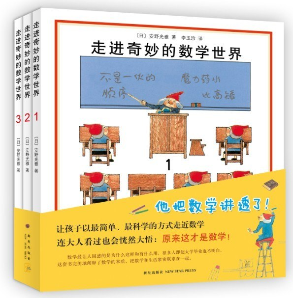

购买：[京东](https://item.jd.com/10081961062973.html)

简介：国际安徒生奖得主安野光雅的经典数学绘本。不讲公式、不刷题，用画面带孩子玩"比较、分类、排序、一一对应"，在看似无字的游戏画面里悄悄埋进数学思想的原点。同一本书不同年龄能读出不同东西，适合亲子共读很多年。

**《你好，数学》**（韩国幼儿教育团队 编 · 适合 3~6 岁）

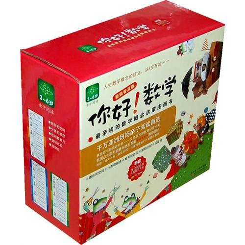

购买：[京东](https://search.jd.com/Search?keyword=%E4%BD%A0%E5%A5%BD%E6%95%B0%E5%AD%A6%E7%BB%98%E6%9C%AC%E5%85%A8%E5%A5%9730%E5%86%8C&enc=utf-8)

简介：韩国权威机构打造的体系化数学绘本：把数、量、图形、规律等概念编进 30 个生活小故事，每册附亲子游戏和小练习，像"轻课程"一样系统，幼小衔接口碑之选。

**《数学帮帮忙》**（Math Matters 引进版 · 适合 5~8 岁）

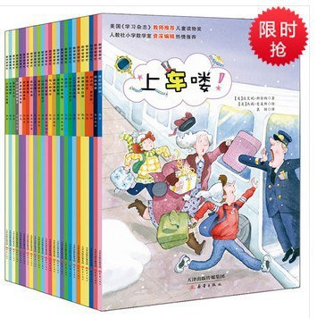

购买：[京东](https://search.jd.com/Search?keyword=%E6%95%B0%E5%AD%A6%E5%B8%AE%E5%B8%AE%E5%BF%99%E6%96%87%E8%95%BE%E5%87%BA%E7%89%88%E7%A4%BE&enc=utf-8)

简介：美国小学课堂常见的"数学桥梁书"：每本一个生活难题（存零花钱、分披萨、赢比赛），对应一个知识点（加减、分数、图表），先讲故事再给"数学妙招"，实用性极强。

**📗 小学（6~12 岁）· 故事与科普**

**李毓佩数学故事系列**（李毓佩 著 · 适合 7~12 岁）

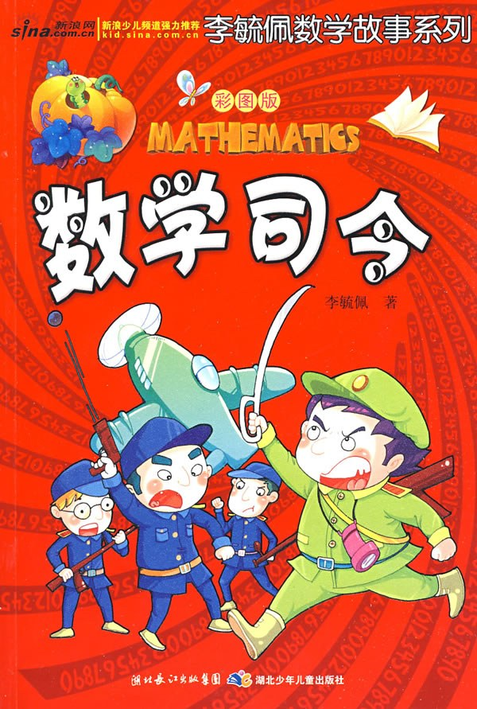

购买：[京东](https://item.jd.com/27560911426.html)

简介：中国数学童话第一人李毓佩的作品集：爱克斯探长、数学司令这些角色用方程、逻辑和计谋破案打仗，故事紧凑，数学知识嵌在情节里，孩子追着故事就把概念记住了。

**《汉声数学图画书》**（台湾汉声 策划 · 适合 6~10 岁）

购买：[京东](https://item.jd.com/10162908731500.html)

简介：台湾汉声出品的大部头图画书系列，请数学家和一线教师把关，把负数、分数、概率、拓扑这些"硬概念"画成温暖的生活故事，一套书覆盖小学数学全部主线，常能传两代。

**《可怕的科学·经典数学》**（尼克·阿诺德 著 · 适合 8~12 岁）

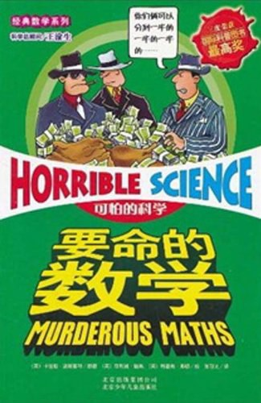

购买：[京东](https://item.jd.com/10158581218336.html)

简介："可怕的科学"系列中的数学分册：用夸张、搞怪甚至有点"恶心"的桥段（蟑螂赛跑、呕吐测量）讲数字、代数与几何。在不爱读书的孩子中口碑奇好，堪称"让孩子主动翻开"的魔法书。

**《数学启蒙》MathStart**（斯图尔特·墨菲 著 · 适合 4~8 岁）

购买：[京东](https://item.jd.com/10028495519161.html)

简介：美国儿童数学绘本名家的分级读物，按难度分三级，每本一个小故事对应一个知识点（时间、估算、位值），文末附亲子活动建议，适合每天一册、细水长流。

**《从小爱数学》**（韩国引进 · 适合 5~10 岁）

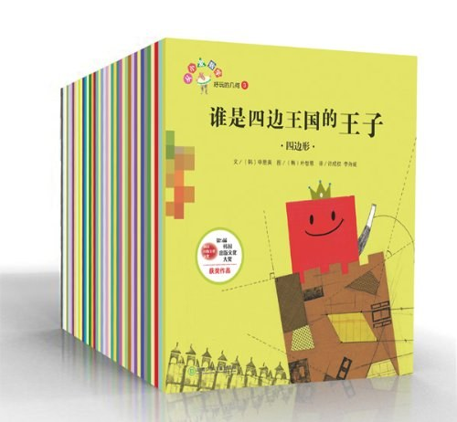

购买：[京东](https://search.jd.com/Search?keyword=%E4%BB%8E%E5%B0%8F%E7%88%B1%E6%95%B0%E5%AD%A6%E7%BB%98%E6%9C%AC%E5%85%A8%E5%A5%9720%E5%86%8C&enc=utf-8)

简介：韩国引进的体系化绘本：故事、游戏、练习一体，覆盖小学课内主要知识点，画风软萌，适合作为课本之外的"兴趣伴读"。

**《DK 儿童数学思维手册》**（DK 出品 · 适合 6~12 岁）

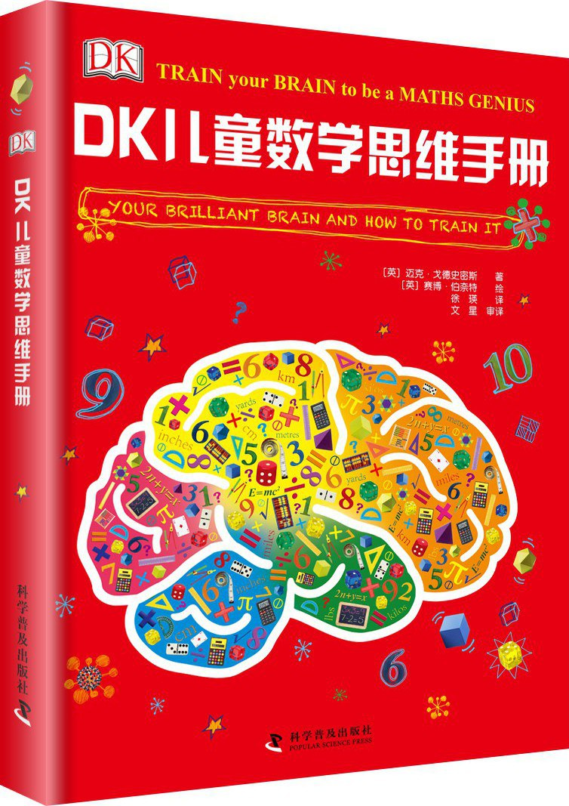

购买：[京东](https://item.jd.com/12025931.html)

简介：DK 一贯的精美图解风：用翻翻页、小实验和挑战题呈现数、形、逻辑与思维游戏，与其说是"书"，不如说是一个能动手玩起来的数学盒子。

**📘 小学高年级 ~ 初中（10 岁+）· 思维与趣味**

**《数学女孩》系列**（结城浩 著 · 适合 12 岁+）

购买：[京东](https://item.jd.com/12616162.html)

简介：日本作家结城浩的现象级数学小说：几位高中生从初学者一路聊到费马大定理、哥德尔不完备定理，硬核推导被写进真实的青春故事里——用小说的方式讲清楚"数学家到底在干什么"。

**《平面国》**（艾勃特 著，1884 · 适合 10 岁+）

购买：[京东](https://item.jd.com/10235366318782.html)

简介：1884 年问世的科幻短篇：一个二维世界里的"正方形"试图理解三维空间，薄薄一册讲透维度、视角与偏见，是阿西莫夫、霍金都推荐过的概念启蒙神作。

**《啊哈！灵机一动》**（马丁·加德纳 著 · 适合 9 岁+）

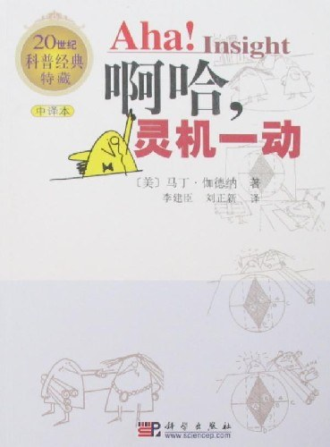

购买：[京东](https://search.jd.com/Search?keyword=%E5%95%8A%E5%93%88%E7%81%B5%E6%9C%BA%E4%B8%80%E5%8A%A8%20%E9%A9%AC%E4%B8%81%E5%8A%A0%E5%BE%B7%E7%BA%B3&enc=utf-8)

简介：趣味数学大师马丁·加德纳的谜题精选：火柴棒、硬币、图形分割……每道题都通向一个"啊哈"时刻，练的正是解题最核心的直觉与巧思。

**《从一到无穷大》**（伽莫夫 著，1947 · 适合 12 岁+）

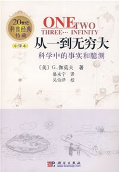

购买：[京东](https://search.jd.com/Search?keyword=%E4%BB%8E%E4%B8%80%E5%88%B0%E6%97%A0%E7%A9%B7%E5%A4%A7%20%E4%BC%BD%E8%8E%AB%E5%A4%AB&enc=utf-8)

简介：物理学家伽莫夫的科普神作：从"数不完的数字游戏"讲到无穷大、相对论和基因，几乎没有公式却把现代科学的骨架讲清，影响了几代科学家。

**《给孩子的数学三书》**（刘薰宇 著 · 适合 10 岁+）

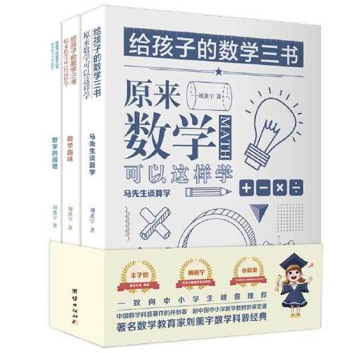

购买：[京东](https://item.jd.com/62617906266.html)

简介：民国数学教育家刘薰宇八十多年前的经典：《马先生谈算学》用对话讲应用题，《数学趣味》讲速算与巧思，《数学的园地》展望高等数学。杨振宁曾公开感谢这套书对自己的影响。

**《数理化通俗演义》**（梁衡 著 · 适合 10 岁+）

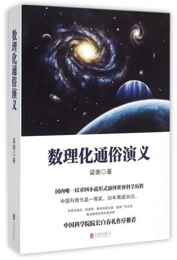

购买：[京东](https://search.jd.com/Search?keyword=%E6%95%B0%E7%90%86%E5%8C%96%E9%80%9A%E4%BF%97%E6%BC%94%E4%B9%89%20%E6%A2%81%E8%A1%A1&enc=utf-8)

简介：作家梁衡用章回体小说的笔法写科学史：一位位科学家成了说书故事里的角色，数理化三科一口气打通，特别适合积累学科背景知识。

**《思考的乐趣：Matrix67 数学笔记》**（顾森 著 · 适合 12 岁+）

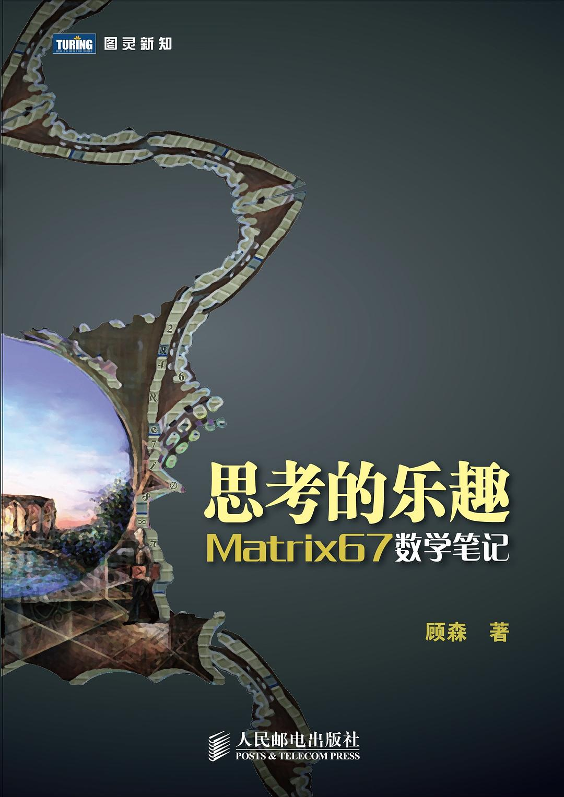

购买：[京东](https://item.jd.com/10059518168982.html)

简介：数学博主 Matrix67（顾森）多年博客精华：从汉诺塔到中文分词、从超市优惠券到密室逃脱，展示一个数学爱好者如何用数学拆解一切，"脑洞密度"极高。

**📙 初中 ~ 高中（13 岁+）· 思想与视野**

**《数学之美》**（吴军 著 · 适合 14 岁+ / 家长同读）

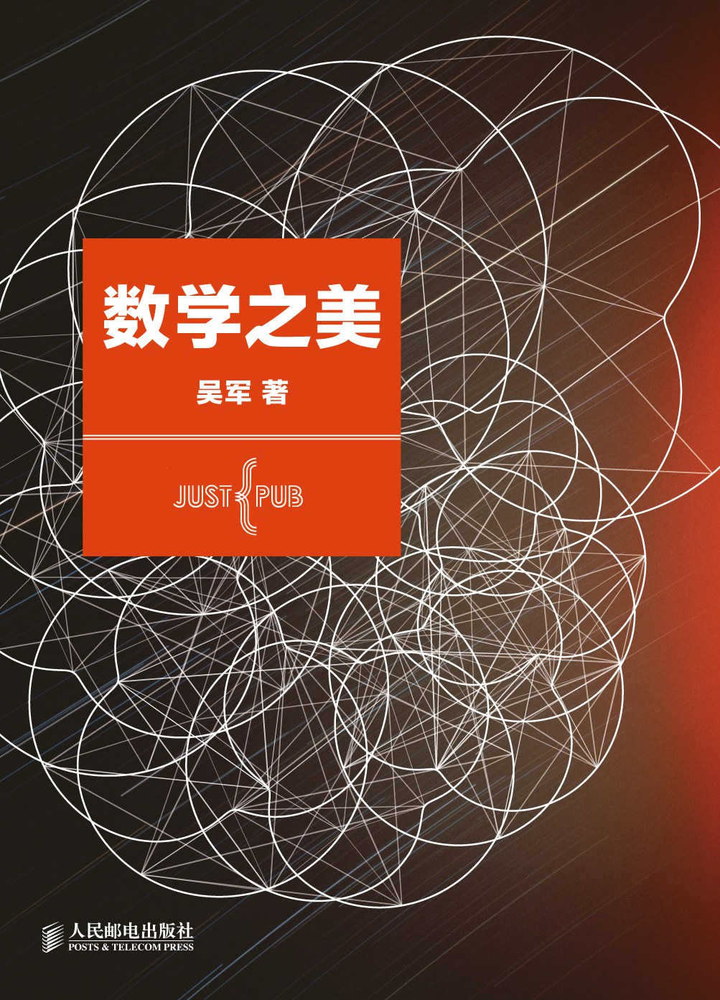

购买：[京东](https://item.jd.com/12646983.html)

简介：吴军的代表作之一：用中学生能懂的数学讲搜索引擎、语音识别、新闻分类背后的原理，把"数学有用"一路讲到人工智能时代。很多章节适合家长和孩子一起读。

**《魔鬼数学》**（乔丹·艾伦伯格 著 · 适合 14 岁+）

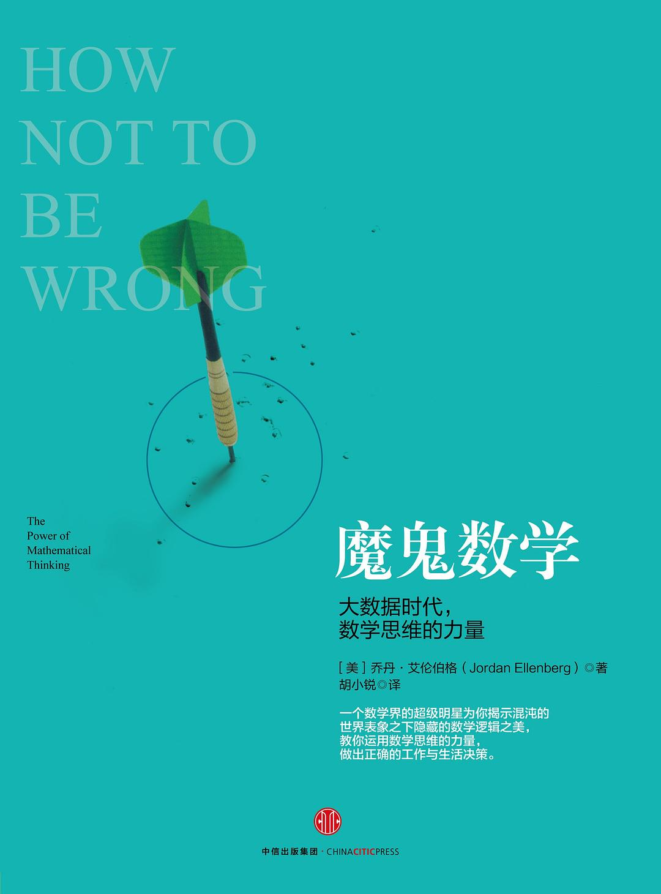

购买：[京东](https://search.jd.com/Search?keyword=%E9%AD%94%E9%AC%BC%E6%95%B0%E5%AD%A6%20%E8%89%BE%E4%BC%A6%E4%BC%AF%E6%A0%BC&enc=utf-8)

简介：数学家艾伦伯格写给你的"防忽悠实战手册"：线性回归能解释新闻里的骗局，期望值能识破彩票与理财话术——与本书"防忽悠素养"一节正好互为呼应。

**《微积分的力量》**（史蒂夫·斯托加茨 著 · 适合 14 岁+）

购买：[京东](https://item.jd.com/10073356742603.html)

简介：数学家斯托加茨的名作：微积分如何预报天气、设计微波炉、刻画艾滋病毒曲线——把"高等数学"还原成一个个改变世界的真实故事，高中选科前的绝佳读物。

**《费马大定理》**（西蒙·辛格 著 · 适合 14 岁+）

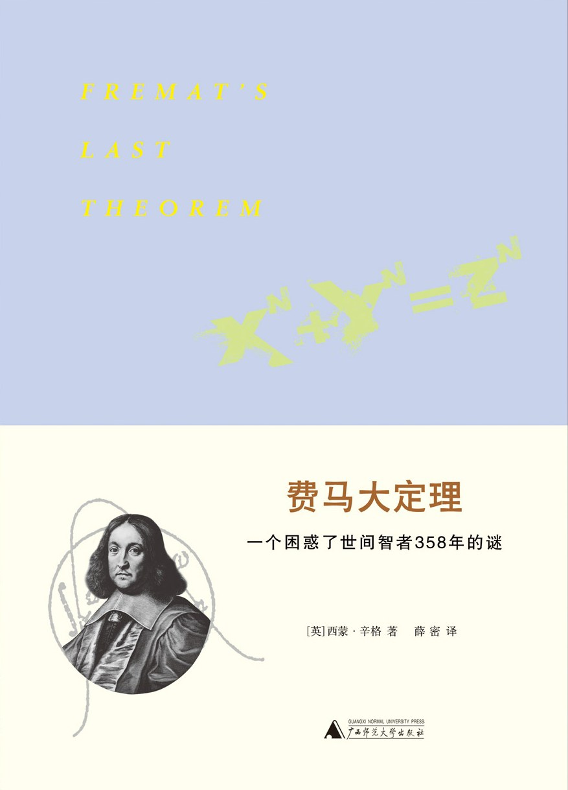

购买：[京东](https://search.jd.com/Search?keyword=%E8%B4%B9%E9%A9%AC%E5%A4%A7%E5%AE%9A%E7%90%86%20%E8%A5%BF%E8%92%99%E8%BE%9B%E6%A0%BC&enc=utf-8)

简介：科学作家辛格的成名作：三百多年里无数数学家前赴后继的"证明接力"，最终由怀尔斯在阁楼里完成——读它像读侦探小说，堪称数学史写作的标杆。

**《密码故事》**（西蒙·辛格 著 · 适合 14 岁+）

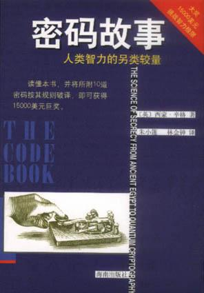

购买：[京东](https://search.jd.com/Search?keyword=%E7%A0%81%E4%B9%A6%20%E7%BC%96%E7%A0%81%E4%B8%8E%E8%A7%A3%E7%A0%81%E7%9A%84%E6%88%98%E4%BA%89&enc=utf-8)

简介：辛格的密码学通史：从凯撒密码、恩尼格玛机到量子加密，密码攻防战串起数学、战争与互联网——与"数学有用"主题完美契合的又一力作。

**《统计数字会撒谎》**（达莱尔·哈夫 著，1954 · 适合 13 岁+）

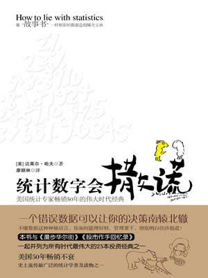

购买：[京东](https://item.jd.com/10038890353119.html)

简介：1954 年的小册子至今畅销：平均数的陷阱、图表如何撒谎、样本偏差有多大坑——每一章都是识破数据话术的"疫苗"，篇幅短小、案例辛辣。

**《改变世界的 17 个方程》**（伊恩·斯图尔特 著 · 适合 14 岁+）

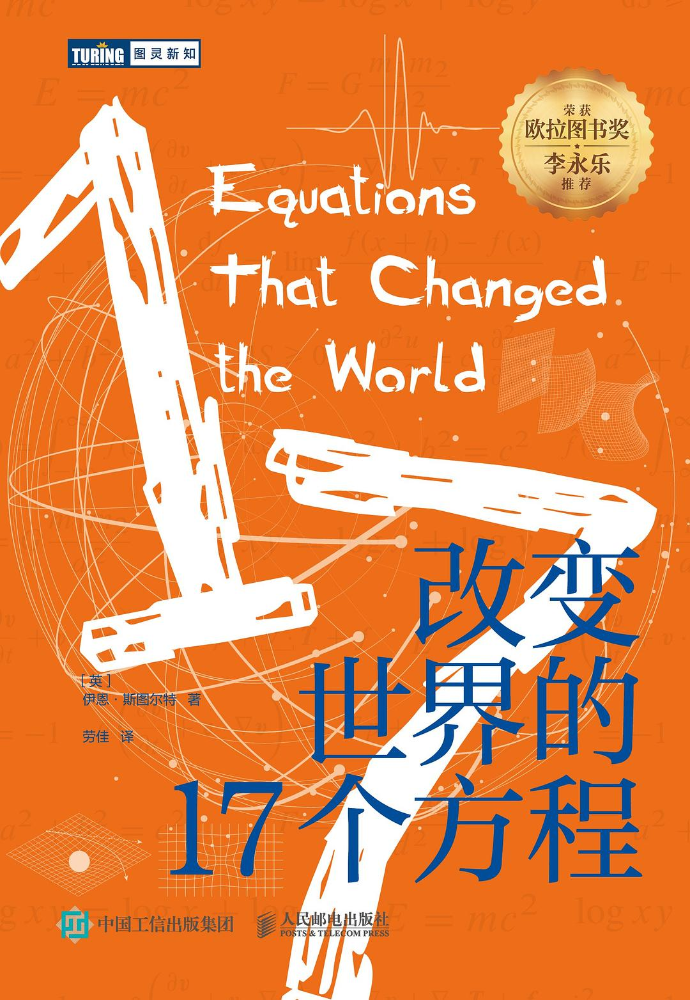

购买：[京东](https://search.jd.com/Search?keyword=%E6%94%B9%E5%8F%98%E4%B8%96%E7%95%8C%E7%9A%8417%E4%B8%AA%E6%96%B9%E7%A8%8&enc=utf-8)

简介：数学家斯图尔特给每个重要方程配一段历史：波动方程与 CD 音质、麦克斯韦方程与无线电、布莱克-斯科尔斯方程与金融危机——方程背后，是整部文明史。

**《牛津通识读本：数学》**（蒂莫西·高尔斯 著 · 适合 15 岁+）

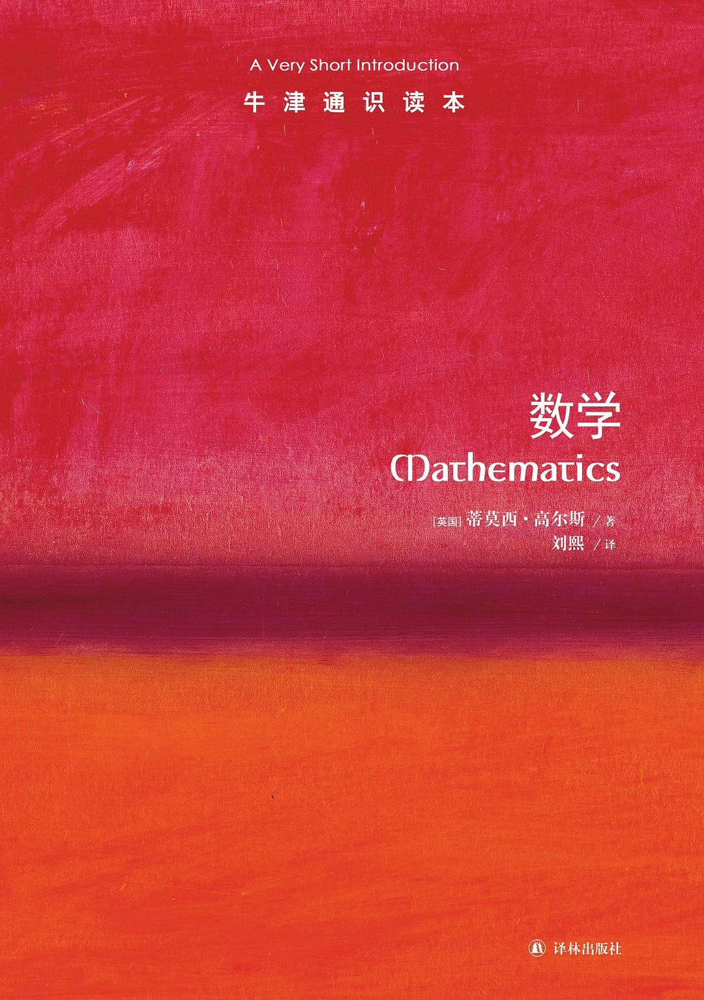

购买：[京东](https://search.jd.com/Search?keyword=%E7%89%9B%E6%B4%A5%E9%80%9A%E8%AF%86%E8%AF%BB%E6%9C%AC%20%E6%95%B0%E5%AD%A6%20%E9%AB%98%E5%B0%94%E6%96%AF&enc=utf-8)

简介：菲尔兹奖得主亲自下场回答"数学是什么"：从证明、无穷到数学与现实的关系，薄薄一册全是干货，适合想"正儿八经懂点数学思想"的读者。

**《数学：确定性的丧失》**（莫里斯·克莱因 著 · 适合 15 岁+）

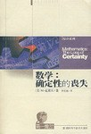

购买：[京东](https://search.jd.com/Search?keyword=%E6%95%B0%E5%AD%A6%20%E7%A1%AE%E5%AE%9A%E6%80%A7%E7%9A%84%E4%B8%A7%E5%A4%B1%20%E5%85%8B%E8%8E%B1%E5%9B%A0&enc=utf-8)

简介：数学史大家克莱因的名作：讲述数学史上的三次"根基地震"——非欧几何、无穷小危机、不完备定理。读完会明白数学大厦也曾多次动摇，适合对数学已有敬畏心的高中生。

**《怎样解题》**（G. 波利亚 著，1945 · 适合 12 岁+ / 家长同读）

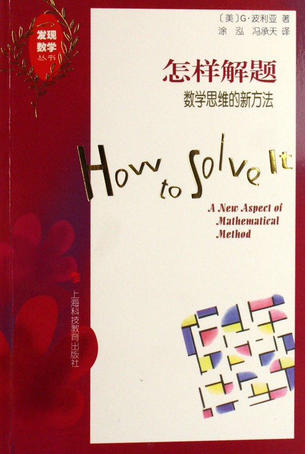

购买：[京东](https://item.jd.com/11885967.html)

简介：数学家波利亚的小册子被译成几十种语言：一张"解题四步表"（理解问题→拟定计划→执行→回顾）影响了全球八十年的数学教育，薄薄一册，值得放在手边反复翻。

**《数学家的眼光》**（张景中 著 · 适合 12 岁+）

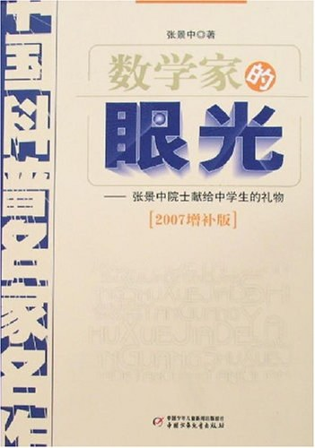

购买：[京东](https://search.jd.com/Search?keyword=%E6%95%B0%E5%AD%A6%E5%AE%B6%E7%9A%84%E7%9C%BC%E5%85%89%20%E5%BC%A0%E6%99%AF%E4%B8%AD&enc=utf-8)

简介：中科院院士张景中的科普短篇集：以"居高临下"的方式重看中小学数学里的老问题，展示真正的数学家如何一眼看穿本质。每篇很短，适合碎片时间读。

**📔 数学家的故事（按阅读能力选读）**

**《数学大师》**（E.T. 贝尔 著，1937 · 适合 13 岁+）

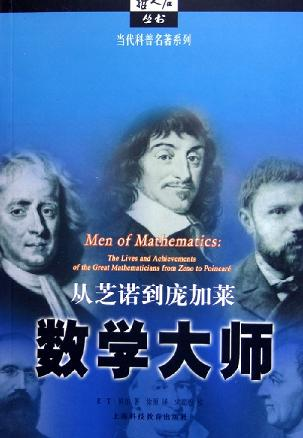

购买：[京东](https://search.jd.com/Search?keyword=%E6%95%B0%E5%AD%A6%E5%A4%A7%E5%B8%88%20%E8%B4%9D%E5%B0%94&enc=utf-8)

简介：数学家群像传记：从阿基米德到康托尔，30 多位数学大师的生平与思想写得跌宕起伏，是激励了几代人的"数学家英雄传"（个别轶闻有演绎成分，读时留意）。

**《知无涯者》**（罗伯特·卡尼格尔 著 · 适合 13 岁+）

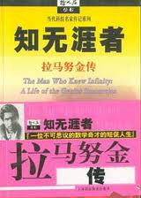

购买：[京东](https://search.jd.com/Search?keyword=%E7%9F%A5%E6%97%A0%E6%B6%AF%E8%80%85%20%E6%8B%89%E9%A9%AC%E5%8A%AA%E9%87%91%E4%BC%A0&enc=utf-8)

简介：拉马努金传记：一个没受过正规训练的印度职员仅凭直觉写下惊天公式，与哈代的合作成为数学史佳话。本书有同名电影，适合先读书、后观影。

**《美丽心灵》**（西尔维娅·娜萨 著 · 适合 14 岁+）

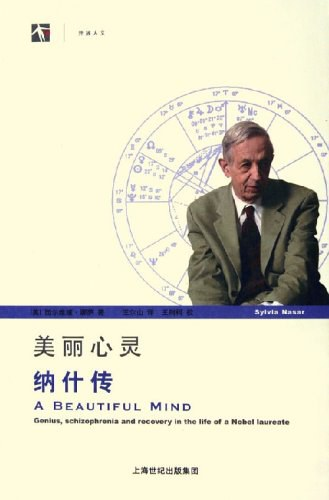

购买：[京东](https://search.jd.com/Search?keyword=%E7%BE%8E%E4%B8%BD%E5%BF%83%E7%81%B5%20%E7%BA%B3%E4%BB%80%E4%BC%A0&enc=utf-8)

简介：纳什传记：博弈论创始人的天才、精神分裂与诺奖回归，故事性极强。有同名奥斯卡电影，可与孩子讨论"电影与史实哪里有出入"。

**《丈量世界》**（丹尼尔·克尔曼 著 · 适合 14 岁+）

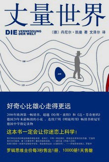

购买：[京东](https://search.jd.com/Search?keyword=%E4%B8%88%E9%87%8F%E4%B8%96%E7%95%8C%20%E4%B8%B9%E5%B0%BC%E5%B0%94%E5%87%AF%E6%9B%BC&enc=utf-8)

简介：德国作家克尔曼的历史小说：洪堡环球探险与高斯"足不出户做数学"的对照，两种天才方式丈量同一个世界，轻松好读，曾长期占据德国畅销书榜。

**📓 家长读**

**《妈妈教的数学》**（孙路弘 著 · 适合家长）

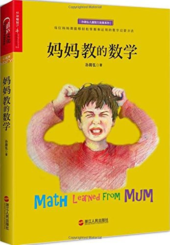

购买：[京东](https://search.jd.com/Search?keyword=%E5%A6%88%E5%A6%88%E6%95%99%E7%9A%84%E6%95%B0%E5%AD%A6%20%E5%AD%99%E8%B7%AF%E5%BC%98&enc=utf-8)

简介：孙路弘结合自身成长经历与教学实践，给出家庭数学启蒙的具体做法：购物、麻将、记账都能变成数学课。实操性最强的中文家教书之一。

**《一个数学家的叹息》**（保罗·洛克哈特 著 · 适合家长/教师）

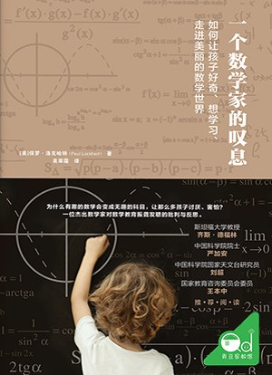

购买：[京东](https://search.jd.com/Search?keyword=%E4%B8%80%E4%B8%AA%E6%95%B0%E5%AD%A6%E5%AE%B6%E7%9A%84%E5%8F%B9%E6%81%AF%20%E6%B4%9B%E5%85%8B%E5%93%88%E7%89%B9&enc=utf-8)

简介：数学家洛克哈特的著名"抗议书"：批评把数学教成机械操作，主张数学是发现与游戏的艺术。篇幅不大，读完会重新思考"我到底该怎么辅导孩子"。

**（3）数学与编程书单**

> 数学与编程互相成就：编程让数学"动起来"，数学让编程"有根基"。这也是一条越来越清晰的升学与职业路径（信息学奥赛、人工智能等）。

**《Hello Ruby：儿童编程大冒险》**（琳达·刘卡斯 著 · 适合 5~9 岁）

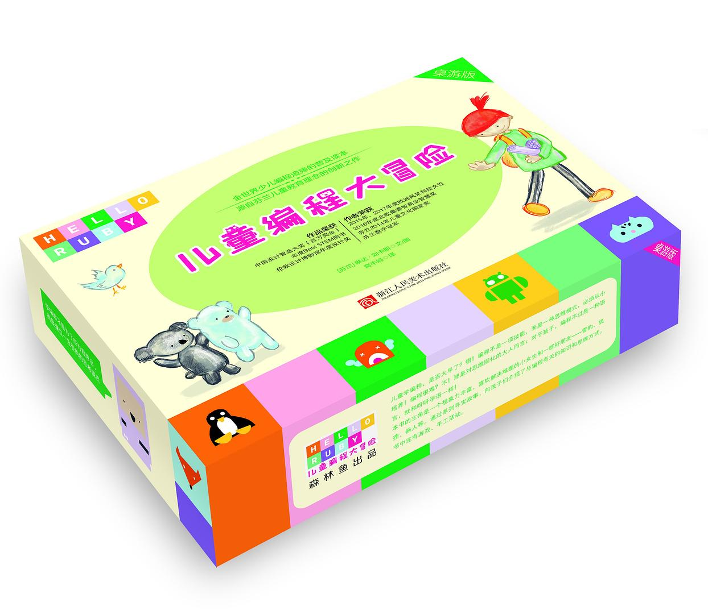

购买：[京东](https://item.jd.com/12304700.html)

简介：芬兰程序员妈妈创作的"不插电"编程绘本：小女孩 Ruby 的冒险故事里藏着排序、循环、模式识别，书后附亲子活动页——不需要电脑就能完成编程思维启蒙。

**《DK 编程真好玩：6岁开始学Scratch》**（乔恩·伍德科克 著 · 适合 6~12 岁）

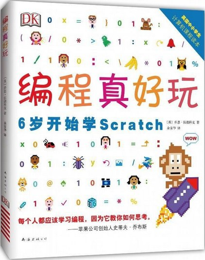

购买：[京东](https://search.jd.com/Search?keyword=DK%E7%BC%96%E7%A8%8B%E7%9C%9F%E5%A5%BD%E7%8E%A9%20Scratch&enc=utf-8)

简介：DK 出品的 Scratch 入门书：跟着步骤做游戏、做动画，坐标、角度、变量悄悄上手，全彩图解对低龄孩子非常友好。

**《父与子的编程之旅：与小卡特一起学Python》**（沃伦·桑德 著 · 适合 10 岁+）

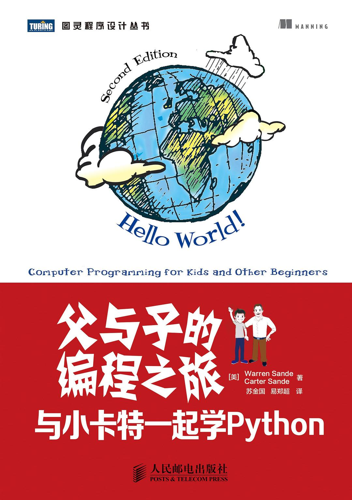

购买：[京东](https://search.jd.com/Search?keyword=%E7%88%B6%E4%B8%8E%E5%AD%90%E7%9A%84%E7%BC%96%E7%A8%8B%E4%B9%8B%E6%97%85%20%E4%B8%8E%E5%B0%8F%E5%8D%A1%E7%89%B9%E4%B8%80%E8%B5%B7%E5%AD%A6Python&enc=utf-8)

简介：程序员爸爸带儿子学 Python 的实录改写而成：语言诙谐、节奏舒缓，用小游戏项目驱动，是亲子共学 Python 的口碑之选，家长零编程基础也能跟上。

**《程序员的数学》系列**（结城浩 著 · 适合 12 岁+）

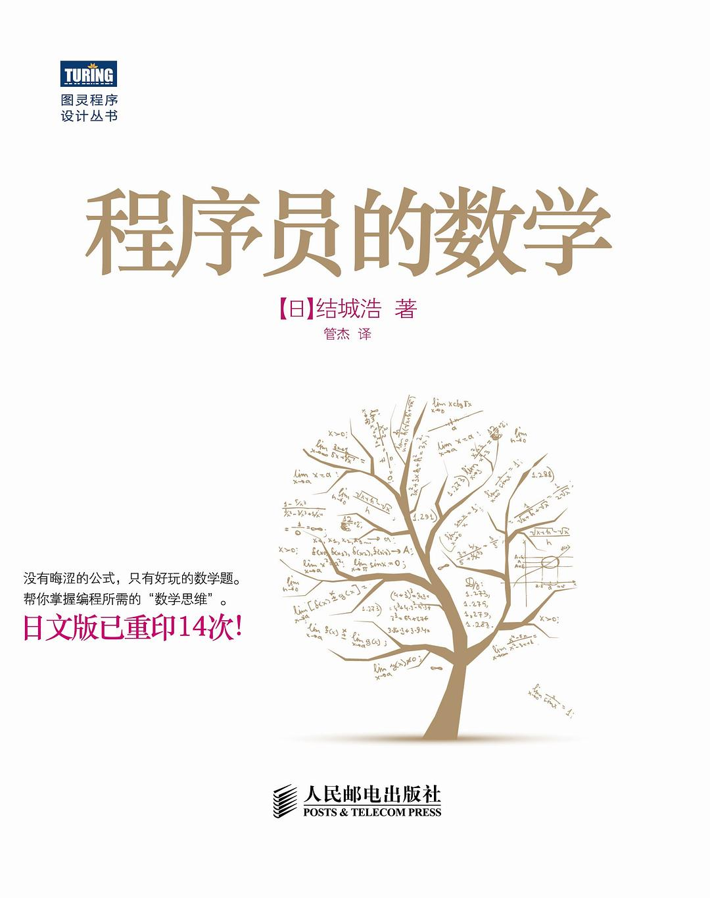

购买：[京东](https://item.jd.com/67270488361.html)

简介：结城浩写给程序员的数学三册：组合、概率、图论与数理逻辑，每章都从问题出发，一路讲到"写程序时怎么用"，把离散数学讲得亲切可读。

**《算法图解》**（阿迪蒂亚·巴格瓦 著 · 适合 12 岁+）

购买：[京东](https://search.jd.com/Search?keyword=%E7%AE%97%E6%B3%95%E5%9B%BE%E8%A7%A3%20%E5%B7%B4%E5%B0%94%E5%8A%A0%E7%93%A6&enc=utf-8)

简介：用图解和日常例子（背包、地图、推荐系统）讲清排序、递归、动态规划等核心算法，零基础友好，是编程自学者的第一本算法书。

**《漫画算法：小灰的算法之旅》**（魏梦舒 著 · 适合 12 岁+）

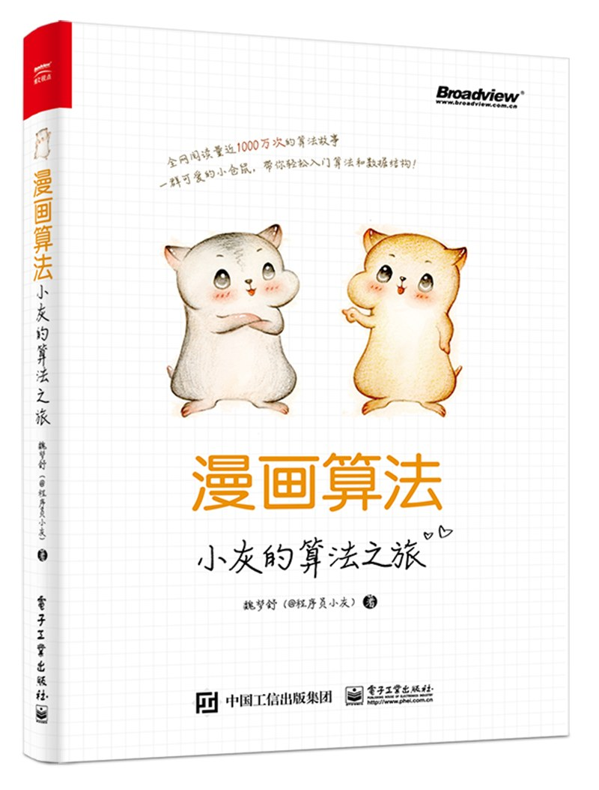

购买：[京东](https://item.jd.com/47193151506.html)

简介：公众号"程序员小灰"的漫画合集：把哈希表、二叉树、动态规划画成面试现场的小故事，轻松幽默，适合零基础建立直观。

**《编码：隐匿在计算机软硬件背后的语言》**（查尔斯·佩措尔德 著 · 适合 14 岁+）

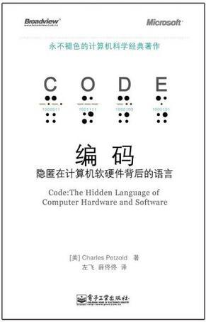

购买：[京东](https://search.jd.com/Search?keyword=%E7%BC%96%E7%A0%81%20%E4%BD%A9%E6%8E%AA%E5%B0%94%E5%BE%B7&enc=utf-8)

简介：从摩尔斯电码、布莱叶盲文一路讲到继电器与 CPU：只用中学知识就讲清计算机的全部原理，被程序员奉为"最底层的启蒙书"，也是数学与工程结合的范本。

**《编程珠玑》**（乔恩·本特利 著 · 适合高中+）

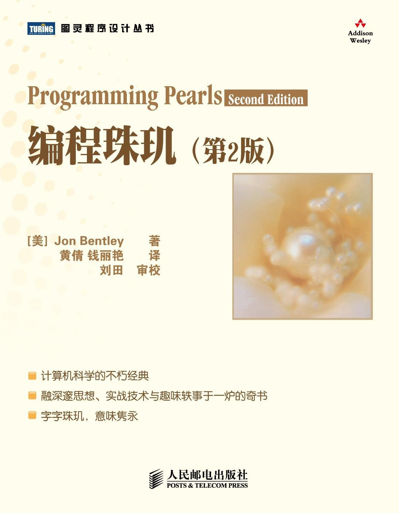

购买：[京东](https://item.jd.com/12243652.html)

简介：贝尔实验室大牛的专栏精华：每篇一个问题（"排序一千万个数需要多少内存？"），短小精悍，展示"编程 + 数学"的思维之美。

**《具体数学》**（高德纳 等 著 · 适合高中竞赛+）

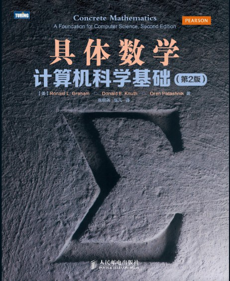

购买：[京东](https://search.jd.com/Search?keyword=%E5%85%B7%E4%BD%93%E6%95%B0%E5%AD%A6%20%E9%AB%98%E5%BE%B7%E7%BA%B3&enc=utf-8)

简介：《计算机程序设计艺术》作者高德纳的讲义：递推、和式、数论、生成函数——信息学奥赛与算法竞赛的数学武器库。难度高，适合立志竞赛的学生。

**（4）数学纪录片清单**

| 片名 | 出品 | 适合 | 看点 | 播放链接 |
|---|---|---|---|---|
| 《数字积木》(Numberblocks) | BBC | 3~7 岁 | 严格说是动画而非纪录片：数字拟人化，数感启蒙神器（中文版 4P 合集，约 136 分钟） | [▶ B站](https://www.bilibili.com/video/BV1jmY16CEj2/) |
| 《唐老鸭漫游数学奇境》 | 迪士尼 1959 | 小学 | 27 分钟动画短片：黄金分割、音乐中的数学，几十年不衰 | [▶ B站](https://www.bilibili.com/video/BV1LW411b7ii/) |
| 《数学的故事》(The Story of Maths) | BBC 2008 | 小学高年级+（可亲子） | 四集数学通史：古巴比伦、古希腊、牛顿到庞加莱 | [▶ B站（4集合集）](https://www.bilibili.com/video/BV1AtmwBfETw/) |
| 《地平线：一根绳子有多长？》 | BBC | 初中 | 从一把尺子讲起测量、误差与极限 | [▶ B站](https://www.bilibili.com/video/BV1pT41137qx/) |
| 《统计的乐趣》(The Joy of Stats) | BBC 2010 | 初中 | 汉斯·罗斯林的数据可视化"表演"，统计学可以这么燃 | [▶ B站](https://www.bilibili.com/video/BV1TJ411y7Mp/) |
| 《解码数学》(The Code) | BBC 2011 | 初中+ | 自然界的数学密码：斐波那契数列、蜂巢与对称 | [▶ B站（3集合集）](https://www.bilibili.com/video/BV1Mx411R7oQ/) |
| 《维度：数学漫步》(Dimensions) | 法国 2008 | 高中 | 九集几何神片：四维空间、复数可视化，官方中字版免费 | [▶ 官方中字](http://www.dimensions-math.org/Dim_ZH_si.htm) · [B站](https://www.bilibili.com/video/BV17E411Q7sm/) |
| 《神秘的混沌理论》 | BBC 地平线系列 | 高中 | 蝴蝶效应、分形与混沌，画面震撼（点开看第 1P 正片） | [▶ B站](https://www.bilibili.com/video/BV1CE411C7PZ/) |
| 《数学大谜思》(The Great Math Mystery) | PBS NOVA 2015 | 高中 | 数学为何能精确描述宇宙？从圆周率到物理定律 | [▶ B站](https://www.bilibili.com/video/BV1vs411d73j/) |
| 《费马最后定理》 | BBC 地平线 1996 | 高中 | 怀尔斯八年苦战的故事，搭配西蒙·辛格同名书阅读更佳 | [▶ B站](https://www.bilibili.com/video/BV1py4y1V7ba/) |

> 以上链接已于 2026 年 10 月逐一验证：页面均可正常打开且与片名匹配；B 站播放免费（1080P 高清需登录账号）。若日后个别链接失效，按片名在站内搜索即可。观看以孩子的兴趣为节奏，亲子一起看、看完聊一聊，效果最好。不必当任务完成。

> 书单不必全买：先去图书馆或书店翻阅，孩子肯主动翻的才是好书。以上均为真实出版物与真实片目，具体版本与译本请自行甄别；警惕打着"思维训练"旗号的超前刷题班。

---

## 八、关键节点与危险期：几月做什么、家长怎么做

> 本章回答两个与时间有关的问题：**升学节点**（幼升小、小升初、中考、高考）各自几月该做什么；以及十二年里几乎人人都会遇到的五个数学"危险期"（陡坡），家长如何早发现、早应对。
>
> 先说明两点：① 招生政策与考试时间**各地差异很大**，本章时间表是通行节奏，具体以当地教育局和学校当年发布为准；② "危险期"不是预言孩子会出问题，而是指**内容抽象度跃升的客观陡坡**——几乎每个孩子都会在陡坡前"咯噔"一下。掉队极少是因为不努力，多是因为旧思维方式一时应付不了新内容。陡坡很正常，关键是早发现、早搭梯子。

### 8.1 四个升学节点时间表（几月做什么）

**总览：**

| 节点 | 关键时间 | 准备周期 | 数学上的核心任务 |
|---|---|---|---|
| 幼升小 | 大班全年（报名多在 5~6 月） | 1 年 | 数感与 10 以内分合；拒绝"小学化"超前 |
| 小升初 | 六年级全年 + 升学暑假 | 1 年半 | 分数四则扎实；算术思维向代数思维过渡 |
| 中考 | 九年级下（各地多在 6 月中下旬） | 九年级全年三轮复习 | 函数与几何综合；基础中档题零失误 |
| 高考 | 高三下（6 月 7~8 日，新高考省份 3~4 天） | 高中三年，高三全年三轮复习 | 五大主干板块体系化；限时套卷节奏 |

**（1）幼升小 · 大班这一年**

| 时间 | 家长做什么 | 数学目标（对照 3.5 节） |
|---|---|---|
| 9~12 月（大班上） | 数感游戏常态化：分水果、扑克牌比大小、串珠找规律；作息逐步向小学靠拢 | 按物点数 1~20 熟练；开始练 10 以内分合 |
| 1~2 月（寒假） | 保持游戏节奏，不放假也不加码；带孩子看看未来就读的小学，建立期待 | 10 以内分合过半（看到 8 能说出 3 和 5） |
| 3~5 月（大班下） | 练"坐得住 20 分钟"和听完整指令再动手；关注报名信息（各地多在 5~6 月，以教育局通知为准） | 10 以内分合脱口而出；会 10 以内加减；认识常见图形与方位 |
| 6~8 月（暑假） | 完成报名；**不上**"小学化"的拼音计算衔接班，每天 10~15 分钟数学游戏即可 | 达到 3.5 节全部能力目标——带着自信和好奇心进小学 |

> 政策提示：公办小学免试就近入学，面谈不得考小学知识。真正要准备的是专注力、倾听习惯和生活自理，不是识字量和计算量。

**（2）小升初 · 六年级与升学暑假**

| 时间 | 家长做什么 | 数学目标（对照 4.3 节） |
|---|---|---|
| 五升六暑假 | 课内查漏：重点过一遍分数四则与单位"1"应用题 | 分数混合运算熟练、规范，4.3 节易错点清零 |
| 六年级上（9~1 月） | 跟紧校内进度，新内容一次学扎实；开始了解当地初中招生方式（直升/划片/电脑派位/民办摇号，各地差异大） | 比和比例、百分数、简易方程一次学透 |
| 六年级寒假 | 小初衔接预热：用字母表示数、负数概念、几何"说理"意识 | 应用题能讲清"为什么这样列式" |
| 六年级下（3~6 月） | 毕业复习跟学校节奏即可，不额外加码；去向政策以当年教育局发布为准 | 小学全部计算内容达到自动化 |
| 升初一暑假 | 预习七年级上册前两章（有理数、整式）；每天 20 分钟计算保温 | 有理数四则会算、符号不丢 |

> 政策提示：全国普遍实行"公民同招"（公办民办同步招生，民办超额摇号），靠"突击奥数拿证书"择校的路径已基本关闭。数学学习的回报回归长期积累——这恰恰是好事。

**（3）中考 · 九年级三轮复习节奏**

| 时间 | 家长做什么 | 数学目标（对照第五章） |
|---|---|---|
| 9~12 月（九上） | 新课收尾期：二次函数、圆、概率恰是中考压轴主力，绝不能"留着复习再说"；督促错题本同步建立 | 新内容一次学透，当天问题当天清 |
| 1~2 月（寒假） | 启动一轮复习：按模块把初中三年教材过一遍，扫知识盲点 | 每个模块能做对课本例题级题目 |
| 3~4 月 | 一轮收尾 → 二轮专题：函数综合、几何综合、压轴题拆解；各地陆续模拟考 | 中档题正确率稳定在九成以上 |
| 5 月 | 二轮收尾 → 三轮：限时套卷、错题回炉；回归课本 | 基础题（约七成分值）做到零失误 |
| 6 月 | 考前两周调作息、减新题；只看错题本和公式卡片 | 会的不丢分，就是最好的冲刺 |

> 提醒：中考命题约七成为基础与中档题，"会的不丢分"比攻克压轴题更划算。中考时间与分值结构各省不同，以本省当年文件为准。

**（4）高考 · 高中三年的整体节奏**

| 时间 | 家长做什么 | 数学目标（对照第六章） |
|---|---|---|
| 高一 ~ 高二上 | 学完必修全部 + 选择性必修主体；高一上先过衔接坎（见 8.3 危险期④） | 函数概念、代数变形两个地基打牢 |
| 高二下 ~ 暑假 | 新课收尾（导数、计数原理、概率统计）；暑假列出薄弱章节清单 | 圆锥曲线与导数不留大坑（见危险期⑤） |
| 高三 9 月 ~ 次年 3 月 | 一轮复习：地毯式过考点，重建知识网络（每章画结构图） | 课本定义、公式、例题逐条过关 |
| 3~5 月 | 二轮专题：函数与导数、解析几何、立体几何、概率统计、选填技巧；一模二模定位 | 专题套路卡片化（设而不求、构造函数等） |
| 5~6 月 | 三轮模拟：套卷限时 + 错题回归 + 心态调整 | 形成自己的答题顺序与时间分配 |

> 高考全国统考时间为 6 月 7~8 日（新高考省份考 3~4 天）。一模二模排名波动很正常：**盯知识点漏洞，不盯分数起伏**。

### 8.2 五个数学"危险期"全景

| 危险期 | 时间窗 | 陡坡内容 | 为什么容易掉队 |
|---|---|---|---|
| ① 三年级现象 | 8~9 岁 | 多位数乘除、两步以上应用题 | 从"算得对"到"想得明白"：读题—分析—列式的链条变长，光靠算得快不够了 |
| ② 五~六年级 | 10~12 岁 | 分数四则、单位"1"、比例、简易方程 | 小学抽象度最高的一段，又撞上小升初；算术思维向代数思维换挡 |
| ③ 初二现象 | 13~14 岁 | 一次函数 + 全等/相似几何证明 | 变量思维与演绎逻辑同时上线，思维方式双重换挡，叠加青春期情绪波动——**全学段分化最严重的一段** |
| ④ 高一上 | 15~16 岁 | 集合与函数概念、抽象度跃升 | 函数从"两个变量的关系"升级为"集合间的对应"；课堂容量与进度远超初中，普遍"听得懂、不会做" |
| ⑤ 高二 | 16~17 岁 | 圆锥曲线、导数、空间向量 | 高考压轴素材的集中地，运算量与综合性陡增；分化在此基本定型 |

【通用规律】五个危险期对应同一个本质：**抽象层级的跃迁点**。在每个跃迁点上，旧的思维方式（点数 → 记忆 → 套路）必须升级为新的（关系 → 符号 → 变量 → 结构）。掉队很少因为"不努力"，多是因为在用旧地图走新路。

### 8.3 危险期家长行动指南

每个危险期按同一结构展开：**为什么会掉队 → 预警信号 → 家长怎么做 → 不要做 → 何时求助**。预警信号比成绩单早出现约半年，值得贴在家里显眼处。

**危险期 ①：三年级（8~9 岁）· 从"算得对"到"想得明白"**

| 维度 | 内容 |
|---|---|
| 为什么会掉队 | 题目从一步计算变成多步应用题，需要"读题—分析—列式"的完整链条；光靠计算快撑不住了 |
| 预警信号 | 应用题空着或乱列式；会算但说不出理由；作业拖延集中在应用题；口算正常但考试波动大 |
| 家长怎么做 | 每天 1~2 道应用题请孩子"讲思路"（重质不重量）；画线段图把条件"摆出来"（见 4.2）；口算打卡不停，保持计算自动化；检查作业先问"你是怎么想的"，不急着给正确答案 |
| 不要做 | 一见错就亲自讲题、替孩子做完；加码刷整套卷子 |
| 何时求助 | 连续一个月应用题正确率明显低于计算题、家长引导无效——找任课老师了解孩子的课堂状态 |

**危险期 ②：五~六年级（10~12 岁）· 算术思维换挡代数思维**

| 维度 | 内容 |
|---|---|
| 为什么会掉队 | 分数四则、单位"1"、比例、方程密集来袭，是小学抽象度最高的一段，同时面临小升初压力 |
| 预警信号 | 分数应用题靠"记题型"套答案；不会判断单位"1"；抗拒方程、只用算术硬推；混合运算错误率上升 |
| 家长怎么做 | 每道分数应用题先问"谁是单位 1、已知还是未知"（见 4.3 易错点）；同一道题算术、方程各做一遍，体会方程的优势；整理数量关系公式本；升学政策提前一年了解，数学上不搞"偏难怪"冲刺 |
| 不要做 | 为小升初盲目刷奥数难题摧毁信心；用"考不上好初中就完了"施压 |
| 何时求助 | 分数四则持续出错、概念题答非所问——说明概念地基有问题，退回课本例题重新理解，必要时请老师做针对性诊断 |

**危险期 ③：初二（13~14 岁）· 函数与几何证明双重换挡**

| 维度 | 内容 |
|---|---|
| 为什么会掉队 | 函数概念（变量思维）与几何证明（演绎逻辑）同时上线，思维方式双重换挡；青春期情绪波动叠加——这是初中两极分化的主战场 |
| 预警信号 | 数学作业时间突然变长；常说"上课听得懂、作业不会做"；几何题大片空白；开始说"我不喜欢数学""我不是学数学的料" |
| 家长怎么做 | 函数抓数形结合：每条性质都在图像上指出来，解析式↔图像双向翻译（见 5.2）；几何证明从"补全证明"练起：给半成品填依据，再独立写；错题本升级为错因本，每周翻一次（见 5.4）；先接住"学不会"的挫败感，再谈方法 |
| 不要做 | 说"这有什么难的"；盲目报大班补习——听不懂的内容在大班课上依然听不懂；拿别人家孩子比较 |
| 何时求助 | 连续两次大考数学明显低于班级平均，或孩子明确说"听不懂课"——尽早约任课老师面谈，定位到具体章节漏洞。这个阶段掉队速度最快，拖一个学期代价翻倍 |

**危险期 ④：高一上（15~16 岁）· 抽象度跃升**

| 维度 | 内容 |
|---|---|
| 为什么会掉队 | 函数升级为"集合间的对应"，抽象化陡增；课堂容量和进度远超初中；自主学习比例上升，家长看不见过程 |
| 预警信号 | "听得懂不会做"成口头禅；作业开始抄答案；初中优势科目成绩跳水；周测排名持续下滑 |
| 家长怎么做 | 升学暑假做好初高衔接：函数概念、因式分解与代数变形熟练度（见 5.5）；帮孩子接受"高中数学本来就更抽象"——先降预期再谈努力（见 7.2）；定义域、单调性条件这类"第一纪律"错误不能放过（见 6.4）；与老师保持沟通，高中家长能做的不多，信息畅通最重要 |
| 不要做 | 用初中成绩否定高中表现（"你初中数学那么好"）；远程遥控刷题量 |
| 何时求助 | 期中期末连续垫底，或孩子长期回避数学——与班主任、任课老师沟通是否需要调整学法，警惕长期"习得性无助"（认定自己不行而放弃尝试） |

**危险期 ⑤：高二（16~17 岁）· 难度与综合性定型期**

| 维度 | 内容 |
|---|---|
| 为什么会掉队 | 圆锥曲线、导数、空间向量三大高峰集中出现，高考压轴题素材主要出自这里；运算量与综合性陡增 |
| 预警信号 | 选科后数学时间被挤压；大题"会一半"——前两问会做、后两问空白；运算失误率上升 |
| 家长怎么做 | 运算量训练常态化：解析几何每天限时做一道完整大题；圆锥曲线"设而不求"、导数"构造函数"等套路整理成卡片（见 6.3）；保障数学时间不被强势科目挤占；高二暑假列出薄弱章节清单，进高三不打无准备之仗 |
| 不要做 | 只刷压轴题忽视中档题；用"还剩一年"制造恐慌 |
| 何时求助 | 中档题正确率持续不稳——优先请老师做试卷分析，定位是知识漏洞还是考试策略问题 |

### 8.4 贯穿所有节点的四条原则

1. **预警信号比成绩单早出现半年**：盯作业状态、情绪和具体题型的表现，不只看分数——作业拖延集中在某类题、突然说"听不懂"，都是比考试更早的信号。
2. **第一对策是"退回最近一个扎实的地方"**：危险期的卡顿几乎都是地基问题。原地加码刷题只会更挫败；退回去把地基补牢再上来，往往一通百通。
3. **家长当好"情报员 + 后勤部长"**：观察信号、保持师生沟通、保障睡眠运动与情绪稳定；具体知识讲解交给课堂和老师——家长可以陪找方法，不必亲自下场讲题。
4. **所有时间表都是参考节奏**：招生政策、复习轮次、考试时间以当地教育局和孩子学校当年安排为准。本章的价值在于"知道什么时候该抬头看路"。

---

## 附录 A：核心素养发展对照表

| 学段 | 核心素养关键词（由具体到抽象递进） |
|---|---|
| 幼儿园 | 兴趣与好奇心、数感萌芽、初步的空间与规律感知 |
| 小学 1~2 年级 | **数感**、运算能力、量感萌芽、几何直观萌芽 |
| 小学 3~4 年级 | 数感、**量感**、**符号意识**、运算能力、几何直观、空间观念、推理意识、数据意识 |
| 小学 5~6 年级 | 符号意识、运算能力、几何直观、空间观念、**推理意识**、数据意识、**模型意识** |
| 初中 7~9 年级 | **抽象能力**、运算能力、几何直观、空间观念、**推理能力**、数据观念、**模型观念**、应用意识、创新意识 |
| 高中 | **数学抽象**、**逻辑推理**、**数学建模**、直观想象、数学运算、数据分析 |

【课标对齐】小学阶段"意识"为主（感悟、体验），初中升级为"观念/能力"（理解、运用），高中达到"思想方法"层面（自觉地用于新情境）。

## 附录 B：全学段易错点速查清单

> 本表查"哪里容易错"；这些错点怎么记住不再错，见附录 D 的"邪修"记忆法。

| 学段 | 高频易错点 |
|---|---|
| 幼儿园 | 点数与说总数脱节；左右方位以自己为参照 |
| 小学低年级 | 进退位漏 1；口诀记混；元角分换算；接近整点的钟面；有余数除法中余数比除数大；万以内数读写中间末尾的 0 |
| 小学中年级 | 试商调商；"平均分"概念缺失；周长面积混淆；平年闰年判断（整百年份需能被 400 整除）；面积单位进率 |
| 小学高年级 | 单位"1"判断；比例尺单位统一；圆柱圆锥 3 倍关系的前提（等底等高）；数对先列后行写反；容积与体积单位混用 |
| 初中 | 移项不变号；不等式乘除负数不变号；分式方程漏验根；函数自变量范围；几何证明跳步；尺规作图漏作图痕迹；科学记数法指数数错 |
| 高中 | 忽略定义域；对数条件丢失；圆锥曲线漏判别式；分类讨论遗漏；概率"放回/不放回"混淆；解三角形正弦定理多解漏解 |

## 附录 C：给家长的通用建议

1. **课内优先，循序渐进**：超前学只能带来短期优势，理解深度和习惯才决定长期走势；学有余力再考虑拓展（如小学高年级奥数、初中竞赛），且以"兴趣+思维训练"为目的而非证书。
2. **盯习惯胜过盯分数**：书写工整、草稿分区、做完检查、错题及时订正——这四个习惯比多刷一本练习册重要得多。
3. **让孩子"讲出来"**：能讲清楚一道题为什么这么做，才是真懂了。家长的角色是当"学生"，不是当"老师"。
4. **关注衔接节点**：幼升小（数的分合）、三四年级（分数概念，第一道分水岭）、五六年级（算术→代数）、初二（函数与几何证明，第二道分水岭）、高一（抽象度跃升）。这些节点上的卡顿，越早发现越好补——详细的时间表与家长行动指南见第八章。
5. **警惕"假熟练"**：计算靠刷出来的速度掩盖不了概念理解的空洞；偶尔让孩子做一道"说一说理由"的开放题，看看思维成色。
6. **数学焦虑会传染**：家长自己对数学的负面情绪尽量少传递给孩子，多展示"数学有用、有趣"的一面。

---

## 附录 D：易错难记点的"邪修"记忆法

> 附录 B 告诉你"哪里容易错"，本附录回答"怎么记住不再错"。这里收集的是流传已久的民间记忆神技——口诀、手势、谐音、比喻，俗称"邪修"：不走寻常路，但见效快的记忆外挂。重点口诀（单位 1、辅助线歌谣、三角函数口诀、试商口诀等）已联网核对来源（2026-10），其余为教材体系长期流传的通用口诀。
>
> **使用纪律（请先读这三条）：**
> 1. **先理解，后口诀**：口诀是把理解"打包压缩"，没理解的口诀考场上想不起来、也用不对。先让孩子搞懂"为什么是这样"，口诀只负责"忘不了"。
> 2. **每条口诀先"验货"再上岗**：启用前用 2 道例题验证孩子真的会用——记错的口诀比没有口诀更糟。
> 3. **有适用条件的，连条件一起背**：比如"的前比后找单位 1"只是快速线索而非定理，复杂句子还得画线段图确认。

### D1 幼小衔接 ~ 小学低年级（计算启蒙期，对应 3.x、4.1 节）

| 难记点 | "邪修"方法 | 说明与边界 |
|---|---|---|
| 20 以内进位加 | **凑十法儿歌**："一九一九好朋友，二八二八手拉手，三七三七真亲密，四六四六一起走，五五凑成一双手" | 先把 10 以内分合练熟再唱；配合小棒摆出"凑十"过程，儿歌负责提速 |
| 20 以内退位减 | **破十法口诀**："减九加一，减八加二，减七加三，减六加四，减五加五"（如 13-9 = 3+1 = 4） | 根子是"把 10 拆出来减"：先用小棒演示 13 拆成 10+3，10 减 9 剩 1，1+3=4 |
| 竖式进退位漏 1 | **打点法**：进上来的"1"写成小字点在旁边，退位在被减数头上点个"借位点" | 检查口诀"有点才算，算完还点"；熟练后再省略 |
| 乘法口诀记混 | ① **想邻居**：忘了 6×7，想 6×6=36 再加一个 6；② **9 的手指法**：双手摊开，算 9×3 弯下左起第 3 指，左边 2 指是十位、右边 7 指是个位 → 27 | 手指法只管 9 的口诀；"想邻居"适用所有口诀，还顺便复习了乘法的意义 |
| > 和 < 分不清 | "大嘴吃大的，尖尖扎小的"（开口总朝大数） | 配合画小鱼张嘴图，一两周就固化 |
| 元角分换算 | **真钱游戏**：每周玩一次"家庭小卖部"，1 元换 10 角现场操作；口诀"元变角添个 0，角变元去个 0" | 口诀只限整数换算；1.5 元=15 角这类靠纸币组合理解 |
| 钟表认读 | "分针跳格要数 5"（一大格=5 分钟）；接近整点："分针没过 12，就读上一家" | 先练整点半点，再练 5 分一跳；"差 5 分 3 点"这类接近整时最易错，多举例 |
| 左右不分 | "写字（拿筷子）的手是右手" | 先以自己身体为参照，再过渡到以对面的人为参照 |
| 有余数除法的余数 | **"余数是小弟，除数是大佬"**——小弟永远大不过大佬；自查口诀"余数比除数大，说明商太小" | 用分东西理解：分完剩的"不够再分一轮"才是余数；够分就说明商小了，商要加一重算 |
| 万以内数读写（中间、末尾的 0） | **读数**："中间有 0 读一个，末尾有 0 都不读"；**写数**："哪位一个也没有，就写 0 占位" | 中间连着几个 0 也只读一个"零"；写数漏 0 占位是高频错——写完数一数位数对不对 |

**例题演练（每法 2 题：先做题，再对照用法，最后看答案）**

1. **凑十法儿歌**（20 以内进位加）
   - 题 1：8 + 5 = ?
     用法：见 8 想 2（"二八手拉手"）：把 5 拆成 2 和 3，8+2 凑成 10，10+3=13。
     答案：13
   - 题 2：9 + 7 = ?
     用法：见 9 想 1（"一九好朋友"）：把 7 拆成 1 和 6，9+1=10，10+6=16。
     答案：16
2. **破十法口诀**（20 以内退位减）
   - 题 1：13 - 9 = ?
     用法："减九加一"：13 拆成 10+3，10 减 9 剩 1，个位 3+1=4。
     答案：4
   - 题 2：15 - 8 = ?
     用法："减八加二"：10 减 8 剩 2，个位 5+2=7。
     答案：7
3. **打点法**（竖式进退位漏 1）
   - 题 1：竖式计算 47 + 36 = ?
     用法：个位 7+6=13，写 3，把进上来的"1"点小在十位旁；十位 4+3，再加小点 1 得 8。
     答案：83
   - 题 2：竖式计算 52 - 28 = ?
     用法：个位 2 不够减 8，在 5 的头上点借位点，5 变 4；个位 12-8=4，十位 4-2=2。
     答案：24
4. **想邻居 + 手指法**（乘法口诀记混）
   - 题 1：6 × 7 = ?
     用法：想邻居：6×6=36，再加一个 6，36+6=42。
     答案：42
   - 题 2：9 × 4 = ?
     用法：手指法：双手摊开，弯下左起第 4 指，左边 3 指是十位、右边 6 指是个位。
     答案：36
5. **大嘴小鱼法**（> 和 < 分不清）
   - 题 1：在 ○ 里填符号：17 ○ 12
     用法：大嘴吃大的：开口朝大数 17。
     答案：17 > 12
   - 题 2：在 ○ 里填符号：9 ○ 15
     用法：尖尖扎小的：尖朝 9、大嘴朝 15。
     答案：9 < 15
6. **元角分口诀**（元角分换算）
   - 题 1：3 元 = ? 角
     用法："元变角添个 0"：3 后面添一个 0。
     答案：30 角
   - 题 2：50 角 = ? 元
     用法："角变元去个 0"：50 去掉一个 0。
     答案：5 元
7. **分针跳格数 5**（钟表认读）
   - 题 1：分针指向 4，是几分？
     用法："分针跳格要数 5"：4 大格 ×5 = 20 分。
     答案：20 分
   - 题 2：分针指向 11、时针快挨到 3，是几时几分？
     用法：11×5=55 分；"分针没过 12，就读上一家"——时针还没真到 3。
     答案：2 时 55 分
8. **右手口诀**（左右不分）
   - 题 1：写字用的是哪只手？
     用法：拿笔（拿筷子）的那只手就是右手。
     答案：右手
   - 题 2：体育课上老师说"请举起左手"，该举哪只？
     用法：不拿笔、不拿筷子的那只就是左手。
     答案：不拿筷子的那只手
9. **余数小弟**（有余数除法的余数）
   - 题 1：17 ÷ 5 = 3 余 2，这个余数 2 合理吗？
     用法："余数是小弟，除数是大佬"——小弟 2 大不过大佬 5 ✓。
     答案：合理（余数必须小于除数）
   - 题 2：小明算 23 ÷ 4 = 4 余 7，对吗？为什么？
     用法：余数 7 比除数 4 还大——说明商小了，商加一重算：23÷4 = 5 余 3。
     答案：不对；应为 5 余 3
10. **读零写零**（万以内数读写）
    - 题 1：读出 5008
      用法："中间有 0 读一个，末尾有 0 都不读"：百位十位连着两个 0，只读一个"零"。
      答案：五千零八
    - 题 2：写出"三千零四十"
      用法："哪位一个也没有，就写 0 占位"：千位 3、百位 0、十位 4、个位 0。
      答案：3040

### D2 小学中高年级（概念与数量关系期，对应 4.2、4.3 节）

| 难记点 | "邪修"方法 | 说明与边界 |
|---|---|---|
| 两位数除法试商 | **试商口诀**："四舍商大减去一，五入商小加上一；同头无除商八九，除数折半商四五" | "同头"=被除数与除数首位相同、"无除"=前两位不够除 → 试 8 或 9（如 239÷26）；被除数前两位约是除数的一半 → 试 4 或 5（如 330÷68）。口诀只管"先试几"，试完必须乘回去验证 |
| 大数读写 | "四位分一级，个十百千照着念"（万级、亿级按个级读法+单位） | 写数先画分级线；"每级末尾的 0 不读"最易错，单独练 |
| 周长面积混淆 | **手势法**：指尖沿边爬一圈=周长（围栅栏），手掌盖一盖=面积（铺草皮）；单位口诀"周长不带平方，面积必带平方" | 混淆多因公式记串——每学一个图形就带孩子推一遍公式来历 |
| 混合运算顺序 | "乘除是大哥，加减是小弟，括号是爷爷——辈分大的先算" | 比喻只管顺序记忆；"添括号改变顺序"的题型仍需理解 |
| 平均分概念 | 分糖果实验："一样多才叫平均分"，分完逐份数一数 | "分成 4 份"≠"平均分成 4 份"，读题时圈出"平均"二字 |
| 单位"1"判断 | **口诀**："是、比、占、相当于"后面找；"的"字前面找；没关键词找"整体"；增减变化找"原来" | 只是快速线索不是定理！复杂句（如"甲比乙多 1/3，乙比丙少 1/4"）必须画线段图确认 |
| 分数比大小 | **蝴蝶法**（交叉相乘）：比较 a/b 与 c/d，a×d 与 b×c 谁大哪边大 | 只用于快速比较和检查；正式作业要写通分过程，考场上当"验算神器" |
| 分数除法 | "除以一个分数，等于乘它的倒数——翻个跟头再乘" | 别只背口诀：用"1÷1/2=2（1 里面有两个一半）"这类实例理解为什么翻转 |
| 比例尺 | "图比实，先统一"（比例尺=图上距离：实际距离，先统一单位再化简） | 放大比例尺（如 10:1）后项才是 1，与地图缩小尺相反，别套反 |
| 圆柱圆锥 3 倍关系 | 倒沙实验+口诀："等底等高才三倍，缺个条件都不算" | 用米和两个杯子就能做实验；易错在忽略"等底等高"前提 |
| 植树问题 | "两头都栽加 1，只栽一头正好，两头不栽减 1"（棵数=间隔数±1） | 用手指缝演示：5 根手指 4 个缝——间隔与棵数的关系一看就懂 |
| 鸡兔同笼 | **抬腿法**："吹哨抬两腿，鸡坐地，剩下的腿除以 2 就是兔" | 本质是假设法：先掌握"假设全是鸡"的正规解法，再把抬腿法当速算彩蛋 |
| 平年闰年判断 | **"四年一闰，百年不闰，四百年再闰"**——普通年份除以 4，整百年份除以 400，能整除才是闰年 | 最高频的坑是整百年份：1900 不是闰年、2000 是；闰年 2 月 29 天、全年 366 天 |
| 面积单位进率 | **"长度进率 10，面积进率 100，体积进率 1000"**——升一次维度，进率就平方一次 | 别把"1 米=100 厘米"直接搬到面积：1 平方米=10000 平方厘米；公顷与平方米是 10000、平方千米与公顷是 100，这两个不按十进制规律，单独记 |
| 数对与位置 | **"先横后竖，先列后行"**——写成 (列, 行)，像电影院先找第几列再找第几排 | 列从左往右数、行从下往上数；写反是高频错，写完默念一遍"列在前" |
| 容积与体积单位 | **"1 升 = 1 立方分米，1 毫升 = 1 立方厘米"**——升和立方分米一样大，毫升和立方厘米一样大 | 容积是"里面能装多少"、体积是"占多大地方"；别跨级混用——1 立方米=1000 升，不是 1 升 |

**例题演练（每法 2 题：先做题，再对照用法，最后看答案）**

1. **试商口诀**（两位数除法试商）
   - 题 1：239 ÷ 26，先试商几？
     用法："同头无除商八九"：首位都是 2（同头），23 不够除 26（无除）→ 试 9；验算 26×9=234，余 5 ✓。
     答案：商 9（239÷26 = 9 余 5）
   - 题 2：330 ÷ 68，先试商几？
     用法："除数折半商四五"：68 折半是 34，33 约等于 34 → 先试 5，68×5=340>330 要退，改试 4，68×4=272 ✓。
     答案：商 4（330÷68 = 4 余 58）
2. **四位分级**（大数读写）
   - 题 1：读出 30500040
     用法：四位分级 3050|0040：万级读"三千零五十万"，个级级首的 0 要读、末尾的 0 不读 → "零四十"。
     答案：三千零五十万零四十
   - 题 2：写出"六亿零七十万"
     用法：分级写：亿级 6，万级 0070，个级 0000，拼起来。
     答案：600700000
3. **手势法**（周长面积混淆）
   - 题 1：给花坛四周围上栅栏，求的是周长还是面积？
     用法：指尖沿边爬一圈——围栅栏求的是"边有多长"。
     答案：周长
   - 题 2：给教室地面铺满地砖，要算砖的块数，求的是什么？
     用法：手掌盖一盖——铺满整个面，求的是"面有多大"。
     答案：面积
4. **辈分口诀**（混合运算顺序）
   - 题 1：30 - 4 × 5 = ?
     用法：乘除是大哥先算：4×5=20，再算 30-20=10。
     答案：10
   - 题 2：(30 - 4) × 5 = ?
     用法：括号是爷爷辈分最大：先算 30-4=26，再算 26×5=130。
     答案：130
5. **分糖果实验**（平均分概念）
   - 题 1：把 12 颗糖分给 4 个小朋友，每人正好 3 颗，是不是平均分？
     用法：逐份数一数：每份都是 3 颗，一样多。
     答案：是平均分
   - 题 2：把 12 颗糖分给 4 个小朋友，分别是 2、4、4、2 颗，是不是平均分？为什么？
     用法："一样多才叫平均分"——四份有多有少。
     答案：不是，每份不一样多
6. **关键词找单位 1**（单位"1"判断）
   - 题 1："男生人数是女生人数的 3/4"，单位"1"是谁？
     用法："是"字后面找——女生人数。
     答案：女生人数
   - 题 2："现价比原价降低了 1/5"，单位"1"是谁？
     用法："比"字后面找（增减变化找"原来"）——原价。
     答案：原价
7. **蝴蝶法**（分数比大小）
   - 题 1：比较 3/4 和 5/7 的大小
     用法：交叉相乘：3×7=21，4×5=20，21>20，左边大。
     答案：3/4 > 5/7
   - 题 2：比较 5/6 和 7/8 的大小
     用法：交叉相乘：5×8=40，6×7=42，40<42，右边大。
     答案：5/6 < 7/8
8. **翻跟头**（分数除法）
   - 题 1：4/5 ÷ 2/3 = ?
     用法：除以 2/3 等于乘它的倒数 3/2：4/5 × 3/2 = 12/10 = 6/5。
     答案：6/5（即 1.2）
   - 题 2：3/7 ÷ 9/14 = ?
     用法：9/14 翻跟头是 14/9：3/7 × 14/9 = 42/63 = 2/3。
     答案：2/3
9. **图比实先统一**（比例尺）
   - 题 1：图上 3cm 表示实际 15km，比例尺是多少？
     用法：先统一单位：15km=1500000cm，再写比 3:1500000=1:500000。
     答案：1:500000
   - 题 2：在 1:200000 的地图上量得 2.5cm，实际距离是多少？
     用法：2.5×200000=500000cm，再换算成千米：500000cm=5km。
     答案：5 km
10. **等底等高才三倍**（圆柱圆锥 3 倍关系）
    - 题 1：圆柱与圆锥等底等高，圆柱体积 24cm³，圆锥体积是多少？
      用法：等底等高才三倍，圆锥是圆柱的 1/3：24÷3=8。
      答案：8 cm³
    - 题 2：圆柱与圆锥等底等高，圆锥体积 9dm³，圆柱体积是多少？
      用法：圆柱是圆锥的 3 倍：9×3=27。
      答案：27 dm³
11. **棵数间隔数**（植树问题）
    - 题 1：20 米长的小路一旁栽树，每隔 5 米一棵，两头都栽，要几棵？
      用法：间隔数 20÷5=4，两头都栽加 1：4+1=5。
      答案：5 棵
    - 题 2：同样的小路，两头都是楼房不能栽，要几棵？
      用法：两头不栽减 1：4-1=3。
      答案：3 棵
12. **抬腿法**（鸡兔同笼）
    - 题 1：鸡兔同笼，8 个头 26 条腿，兔有几只？
      用法：吹哨抬两腿：8×2=16 条腿抬起，地上剩 26-16=10 条全是兔腿，10÷2=5。
      答案：兔 5 只（鸡 3 只）
    - 题 2：10 个头 28 条腿，鸡兔各几只？
      用法：抬两腿：10×2=20，剩 28-20=8，8÷2=4 只兔；鸡 10-4=6。
      答案：兔 4 只，鸡 6 只
13. **四年一闰**（平年闰年判断）
    - 题 1：2024 年是闰年吗？
      用法：普通年份除以 4：2024÷4=506 能整除。
      答案：是闰年（2 月 29 天，全年 366 天）
    - 题 2：1900 年和 2000 年是闰年吗？
      用法：整百年份除以 400：1900÷400 除不尽 → 平年；2000÷400=5 能整除 → 闰年。
      答案：1900 年是平年，2000 年是闰年
14. **进率平方**（面积单位进率）
    - 题 1：3 平方米 = ? 平方分米
      用法："长度进率 10，面积进率 100"：1 米=10 分米，1 平方米=100 平方分米。
      答案：300 平方分米
    - 题 2：5 公顷 = ? 平方米
      用法：公顷与平方米单独记：1 公顷=10000 平方米。
      答案：50000 平方米
15. **先列后行**（数对与位置）
    - 题 1：小明坐在第 3 列第 5 行，用数对怎么表示？
      用法："先横后竖，先列后行"：列在前、行在后。
      答案：(3, 5)
    - 题 2：数对 (7, 2) 表示的位置是？
      用法：读的时候同样先列后行：第 7 列第 2 行。
      答案：第 7 列第 2 行
16. **升与立方分米**（容积与体积单位）
    - 题 1：一个正方体盒子，内部棱长 1 分米，能装多少升水？
      用法："1 升=1 立方分米"：内部容积 1 立方分米。
      答案：1 升
    - 题 2：2 立方米 = ? 升
      用法：别跨级混用——1 立方米=1000 立方分米=1000 升。
      答案：2000 升

### D3 初中（符号与证明期，对应第五章）

| 难记点 | "邪修"方法 | 说明与边界 |
|---|---|---|
| 有理数乘法符号 | "同号得正，异号得负" | 课本官方口诀，少数值得死记硬背的条目 |
| 移项变号 | "等号是国境线，过桥要换护照（变号）" | 本质是等式两边同加同减——理解后比喻可以退休 |
| 不等式变号 | "乘除负数要翻脸（不等号方向调头），加减随便不翻脸" | 与移项对照记：移项过等号要变号；不等式乘除负数要翻方向 |
| 完全平方公式 | "首平方，尾平方，首尾两倍放中央，符号跟前一个样"（(a±b)² = a²±2ab+b²） | 先用面积图（边长 a+b 的正方形分 4 块）推一遍，专治"丢掉 2ab" |
| 因式分解 | "一提（公因式）二套（公式）三十字（相乘），分组分解看情况" | 口诀定检查顺序；分解完一定要乘回去验算 |
| 分式方程验根 | "解完必验根，分母为零是增根" | 验根是得分步骤不是可选动作；养成收尾必写"经检验……"的肌肉记忆 |
| 几何辅助线 | **民间歌谣**："图中有角平分线，可向两边作垂线；也可将图对折看，对称以后关系现。线段垂直平分线，常向两端把线连。要证线段倍与半，延长缩短可试验。三角形中两中点，连接则成中位线；三角形中有中线，延长中线等中线" | 歌谣只提示"常见入口"，具体作哪条仍要分析求证目标；每作一条辅助线都要能说出依据（流传版本略有出入，意思一致即可） |
| 自变量取值范围 | "先问 x 能取啥，再动笔" | 应用题里"人数是非负整数""边长为正"这类隐藏条件，读题时先圈出来 |
| 一次函数图像 | "k 正上坡 k 负下坡，b 是 y 轴落脚点" | 配合双向练习三遍：给解析式画图、给图读 k 与 b 的符号 |
| 韦达定理 | "之和带负号（x₁+x₂ = -b/a），之积照原样（x₁x₂ = c/a）" | 用 (x-x₁)(x-x₂)=0 展开推一遍再背；a≠1 时先两边除以 a |
| 尺规作图痕迹 | **"尺规作图三件套：留弧、留点、留连线"**——痕迹不擦，才给分 | 作图痕迹是评分点：弧线、交点、连线都要留在图上；"画对了但擦干净"会判零分 |
| 科学记数法 | **"小数点搬到大数身后，搬了几格指数就是几"**（a×10ⁿ，1≤\|a\|<10）；速算："指数 = 整数位数 - 1" | 小数用负指数（0.00035=3.5×10⁻⁴）；最高频错是数错位数——写完数一遍原数有几位 |

**例题演练（每法 2 题：先做题，再对照用法，最后看答案）**

1. **同号异号**（有理数乘法符号）
   - 题 1：(-3) × (-5) = ?
     用法：同号得正：3×5=15，符号为正。
     答案：15
   - 题 2：(-4) × 6 = ?
     用法：异号得负：4×6=24，带上负号。
     答案：-24
2. **国境线**（移项变号）
   - 题 1：解方程 3x + 5 = 14
     用法：+5 过等号国境线换护照变 -5：3x=14-5=9，x=3。
     答案：x=3
   - 题 2：解方程 5x - 7 = 2x + 8
     用法：2x 过桥变 -2x，-7 过桥变 +7：5x-2x=8+7，3x=15，x=5。
     答案：x=5
3. **翻脸**（不等式变号）
   - 题 1：解不等式 -2x > 6
     用法：两边除以负数 -2 要翻脸：> 调头变 <。
     答案：x < -3
   - 题 2：解不等式 x - 4 ≤ 5
     用法：加减不翻脸：x ≤ 5+4。
     答案：x ≤ 9
4. **首尾口诀**（完全平方公式）
   - 题 1：展开 (x + 3)²
     用法：首平方 x²，尾平方 9，首尾两倍 2·x·3=6x 放中央，符号跟前一个样（+）。
     答案：x² + 6x + 9
   - 题 2：展开 (2a - 5)²
     用法：首平方 4a²，尾平方 25，首尾两倍 20a 放中央，符号跟前一个样（-）。
     答案：4a² - 20a + 25
5. **一提二套三十字**（因式分解）
   - 题 1：分解 3x² + 6x
     用法：一提：公因式 3x → 3x(x+2)；乘回去验算 ✓。
     答案：3x(x+2)
   - 题 2：分解 x² + 5x + 6
     用法：一提没有、二套套不上 → 三十字：2×3=6 且 2+3=5 → (x+2)(x+3)；验算 ✓。
     答案：(x+2)(x+3)
6. **验根**（分式方程验根）
   - 题 1：解 2/x = 1/(x-1) 得 x=2，还要做什么？
     用法：解完必验根：x=2 时两个分母分别为 2、1，都不为 0。
     答案：经检验，x=2 是原方程的根
   - 题 2：解 x/(x-1) = 1/(x-1) 得 x=1，是根吗？
     用法：验根：x=1 使分母 x-1=0 → 增根，舍去。
     答案：x=1 是增根，原方程无解
7. **辅助线歌谣**（几何辅助线）
   - 题 1：D、E 分别是 AB、AC 的中点，要研究 DE 与 BC 的关系，辅助线怎么作？
     用法："三角形中两中点，连接则成中位线"——连接 D、E。
     答案：连接 DE（中位线：DE∥BC 且 DE=½BC）
   - 题 2：△ABC 中 AO 是 BC 边上的中线，要证与中线有关的倍分关系，常用哪招？
     用法："三角形中有中线，延长中线等中线"——延长 AO 至 D 使 OD=AO，拼出平行四边形。
     答案：倍长中线（把中线延长一倍）
8. **先问 x 能取啥**（自变量取值范围）
   - 题 1：求 y = √(x-2) 中 x 的取值范围
     用法：先问 x 能取啥：根号下不能为负，x-2≥0。
     答案：x ≥ 2
   - 题 2：用 20cm 篱笆围矩形，设长为 x cm，写面积函数时 x 的范围？
     用法：隐藏条件"边长为正"：长 x>0，宽 (10-x)>0。
     答案：0 < x < 10
9. **k 与 b**（一次函数图像）
   - 题 1：y = 2x + 3 的图像从左到右怎么走？与 y 轴交在哪？
     用法：k 正上坡：上升；b 是 y 轴落脚点：交于 (0,3)。
     答案：从左到右上升，交 y 轴于 (0,3)
   - 题 2：一条直线从左到右下降，且交 y 轴负半轴，k、b 的符号是？
     用法：下坡 k 负；落脚点在 y 轴负半轴 b 负。
     答案：k < 0，b < 0
10. **之和之积**（韦达定理）
    - 题 1：不解方程，求 x² - 5x + 6 = 0 的两根之和与之积
      用法：之和带负号：-(-5)/1=5；之积照原样：6/1=6。
      答案：和 = 5，积 = 6
    - 题 2：求 2x² + 4x - 6 = 0 的两根之和
      用法：a≠1 先两边除以 2：x²+2x-3=0，之和带负号。
      答案：-2
11. **作图三件套**（尺规作图痕迹）
    - 题 1：用尺规作线段 AB 的垂直平分线，画完线后要保留什么？
      用法："留弧、留点、留连线"：以 A、B 为圆心画弧的交点要留，连线要留。
      答案：保留两弧交点与所作直线（痕迹不擦）
    - 题 2：作一个角等于已知角，评分看什么？
      用法：作图痕迹是评分点——弧线、交点都要留在图上。
      答案：看是否保留作图痕迹（擦干净会判零分）
12. **搬小数点**（科学记数法）
    - 题 1：用科学记数法表示 305000
      用法："指数 = 整数位数 - 1"：6 位数 → 指数 5；3.05×10⁵。
      答案：3.05×10⁵
    - 题 2：用科学记数法表示 0.00035
      用法：小数点右移 4 格到 3.5，小数用负指数。
      答案：3.5×10⁻⁴

### D4 高中（抽象体系期，对应第六章）

| 难记点 | "邪修"方法 | 说明与边界 |
|---|---|---|
| 定义域 | "函数问题，定义域先行——先划地盘再做题" | 对数真数>0、偶次根号下≥0、分母≠0；做题前先列"限制条件清单" |
| 函数奇偶性运算 | "奇乘奇得偶，偶乘偶得偶，奇乘偶得奇"——把"奇"想成一个负号：负负得正 | 与整数运算"奇×奇=奇"不同，正是易混点，对照记更牢 |
| 复合函数单调性 | "同增异减"（内外层单调性相同→整体增，不同→整体减） | 前提：先求定义域，单调区间必须落在定义域内 |
| 指数对数运算 | "同底幂相乘指数加；同底对数加真数乘，对数减真数除，真数指数搬前面" | 纪律："底数>0 且≠1，真数>0——先查户口再运算" |
| 诱导公式 | "奇变偶不变，符号看象限"（奇偶指 π/2 的奇数倍还是偶数倍）；配套象限歌"一全正，二正弦，三两切，四余弦" | "符号看象限"指把角当成锐角时原函数的符号；拿不准就画单位圆 |
| 特殊角三角函数值 | "分母弦二切是三，分子要把根号添；一二三来三二一，切值三九二十七"（sin30°/45°/60° = √1/2、√2/2、√3/2，cos 倒序，tan = √3/3、1、√3） | 另一招：sin 从 0° 到 90° 依次是 √0/2、√1/2、√2/2、√3/2、√4/2，根号里 0 到 4 顺数——两种挑顺手的 |
| 椭圆双曲线 a、b、c | "椭圆 a 是老大（a²=b²+c²），双曲 c 是老大（c²=a²+b²）" | 记反是高频错误；顺带记离心率 e=c/a：椭圆 0<e<1，双曲线 e>1 |
| 基本不等式 | "一正二定三相等"（各项为正、和或积为定值、等号能取到） | 用前默念三条件，尤其"三相等"——等号取不到时基本不等式不适用，要换方法 |
| 排列组合 | "有序排列，无序组合；相邻问题捆绑法，不相邻问题插空法；特殊元素先安排" | 先判断"有没有顺序"再选公式；A 与 C 混用是最常见扣分点 |
| 扇形面积 | "把扇形当三角形：弧长当底、半径当高，S = ½lR" | 类比三角形面积 ½×底×高；弧长公式 l = \|α\|·r 一起记 |
| 外接球（墙角模型） | "三条棱两两垂直 → 补成长方体，外接球直径 = 体对角线"（2R = √(a²+b²+c²)） | "补形"思想也适用于四个面都是直角三角形的四面体等模型 |
| 概率 | "放回不放回，分母两世界；正面难算就算反面（P = 1 - P(对立事件)）" | 摸球题先写一句"放回/不放回"再列式；"正难则反"尤其适用于"至少有一个" |
| 解三角形（正弦定理多解） | **"已知两边一对角，可能两解要小心"**——正弦定理求出角后，别忘了用"大边对大角"和"内角和 180°"把不合法的解挑出去 | 已知两边及其中一边的对角（SSA）时可能有两解：求出的角若与已知角相加超过 180°，或与"大边对大角"矛盾，就要舍去；已知两边夹角（SAS）或三边（SSS）优先用余弦定理 |
| 彩蛋：圆周率前几位 | **谐音**："山巅一寺一壶酒" = 3.14159 | 纯娱乐，续句版本众多；当个乐子，顺便给孩子讲讲 π 为什么神奇 |

**例题演练（每法 2 题：先做题，再对照用法，最后看答案）**

1. **先划地盘**（定义域）
   - 题 1：求 f(x) = lg(x-1) 的定义域
     用法：先划地盘：对数真数>0，x-1>0。
     答案：x > 1，即 (1, +∞)
   - 题 2：求 f(x) = √(x+2)/x 的定义域
     用法：列限制清单：根号下 x+2≥0，且分母 x≠0。
     答案：x ≥ -2 且 x ≠ 0
2. **奇偶乘法**（函数奇偶性运算）
   - 题 1：f 是奇函数、g 是奇函数，f·g 是什么函数？
     用法：奇乘奇得偶（负负得正）。
     答案：偶函数
   - 题 2：f 是偶函数、g 是奇函数，f·g 是什么函数？
     用法：奇乘偶得奇（正乘负得负）。
     答案：奇函数
3. **同增异减**（复合函数单调性）
   - 题 1：y = √(x²) 在 (0,+∞) 上：内层 t=x² 增、外层 y=√t 增，整体单调性？
     用法：同增异减：增+增=同 → 整体增。
     答案：增函数
   - 题 2：y = 1/(x-1) 在 (1,+∞) 上：内层 t=x-1 增、外层 y=1/t 减，整体单调性？
     用法：一增一减=异 → 整体减。
     答案：减函数
4. **查户口再运算**（指数对数运算）
   - 题 1：计算 log₂4 + log₂8
     用法：同底对数加，真数乘：log₂(4×8)=log₂32=5。
     答案：5
   - 题 2：计算 2lg5 + lg4
     用法：真数指数搬前面：2lg5=lg25；同底加真数乘：lg(25×4)=lg100=2。
     答案：2
5. **奇变偶不变**（诱导公式）
   - 题 1：化简 sin(π - α)
     用法：π 是 π/2 的 2 倍，偶不变，还是 sin；α 当锐角时 π-α 在第二象限，sin 为正。
     答案：sin α
   - 题 2：化简 cos(π/2 + α)
     用法：π/2 是 1 倍，奇变，cos 变 sin；π/2+α 在第二象限，cos 为负。
     答案：-sin α
6. **一二三来三二一**（特殊角三角函数值）
   - 题 1：sin 30° = ?
     用法："一二三来"：√1/2。
     答案：1/2
   - 题 2：tan 60° = ?
     用法："切值三九二十七"：分母都是 3，分子根号里 3、9、27 → tan60°=√27/3=√3。
     答案：√3
7. **谁是老大**（椭圆双曲线 a、b、c）
   - 题 1：椭圆中 b=3、c=4，求 a
     用法：椭圆 a 是老大：a²=b²+c²=9+16=25。
     答案：a=5
   - 题 2：双曲线中 a=3、b=4，求 c 和离心率 e
     用法：双曲 c 是老大：c²=a²+b²=25，c=5；e=c/a=5/3。
     答案：c=5，e=5/3
8. **一正二定三相等**（基本不等式）
   - 题 1：求 x + 4/x（x>0）的最小值
     用法：一正（x>0 ✓）二定（积 x·4/x=4 是定值 ✓）三相等（x=4/x 即 x=2 能取到 ✓）：x+4/x ≥ 2√4=4。
     答案：最小值 4（当 x=2 时取得）
   - 题 2：x + 4/x 在 x≥3 时，能用基本不等式取到最小值 4 吗？
     用法：三相等要求 x=2，不在 x≥3 里，等号取不到 → 基本不等式不适用，要换方法（用单调性，x=3 时取 13/3）。
     答案：不能；等号取不到时须换方法
9. **捆绑插空**（排列组合）
   - 题 1：5 人排成一队，甲乙必须相邻，有几种排法？
     用法：相邻捆绑法：甲乙捆成 1 个"大元素"，4 个元素排 4!=24 种，甲乙内部 2 种，24×2=48。
     答案：48 种
   - 题 2：5 人排成一队，甲乙不相邻，有几种排法？
     用法：不相邻插空法：先排其余 3 人 3!=6 种，产生 4 个空档，插进甲乙 A(4,2)=12 种，6×12=72。
     答案：72 种
10. **当三角形**（扇形面积）
    - 题 1：半径 6、弧长 4 的扇形，面积是多少？
      用法：当三角形：弧长当底、半径当高，S=½lR=½×4×6=12。
      答案：12
    - 题 2：半径 3、圆心角 2 弧度的扇形，面积是多少？
      用法：先求弧长 l=|α|·r=2×3=6，再当三角形 S=½lR=½×6×3=9。
      答案：9
11. **墙角模型**（外接球）
    - 题 1：三条棱两两垂直、长度分别为 1、2、2 的三棱锥，外接球半径是多少？
      用法：补成长方体：2R=√(1²+2²+2²)=√9=3。
      答案：R = 3/2
    - 题 2：长方体长、宽、高为 2、3、6，外接球直径是多少？
      用法：直径=体对角线：√(2²+3²+6²)=√49=7。
      答案：直径 7
12. **正难则反**（概率）
    - 题 1：袋中 3 红球 2 白球，不放回摸 2 个，求"至少一个红球"的概率
      用法：正难则反：1-P（两个都白）=1-(2/5×1/4)=1-1/10=9/10。
      答案：9/10
    - 题 2：同样的袋子，改为放回摸 2 次，"至少一个红球"的概率？
      用法：放回分母两世界：P（两次都白）=(2/5)²=4/25，1-4/25=21/25。
      答案：21/25
13. **π 谐音**（彩蛋：圆周率前几位）
    - 题 1："山巅一寺一壶酒"对应 π 的前几位？
      用法：谐音直译：山(3)巅(1)一(1)寺(4)一(1)壶(5)酒(9)。
      答案：3.14159
    - 题 2：接上句"尔乐苦煞吾"（2 6 5 3 5），写出 π 的前 10 位
      用法：两段拼接：3.14159 接上 26535。
      答案：3.1415926535
14. **两边一对角**（解三角形正弦定理多解）
    - 题 1：△ABC 中 a=2、b=2√2、A=30°，求 B
      用法：正弦定理 sinB = b·sinA/a = 2√2×0.5/2 = √2/2 → B=45° 或 135°；两个都能与 A=30° 相加小于 180°（45+30=75、135+30=165）✓；又 b>a 所以 B>A，两解都成立。
      答案：B = 45° 或 135°（两解）
    - 题 2：△ABC 中 a=√2、b=√3、B=60°，求 A
      用法：正弦定理 sinA = a·sinB/b = √2×(√3/2)/√3 = √2/2 → A=45° 或 135°；因为 a<b 所以 A<B=60°，135° 不满足，舍去。
      答案：A = 45°（只有一解——这就是"多解要挑"的典型）

> 最后重复一遍原则：**口诀是"压缩包"，理解才是"源文件"**。孩子哪天口诀卡壳了，能退回到理解重新推导，才算真正学会。

---

*本规划依据 2022 版《义务教育数学课程标准》、2017 版《普通高中数学课程标准》组织，并结合儿童数学能力发展的一般规律编写。各学段内容与学校教学进度如有出入，以学校教材和教师要求为准。*
